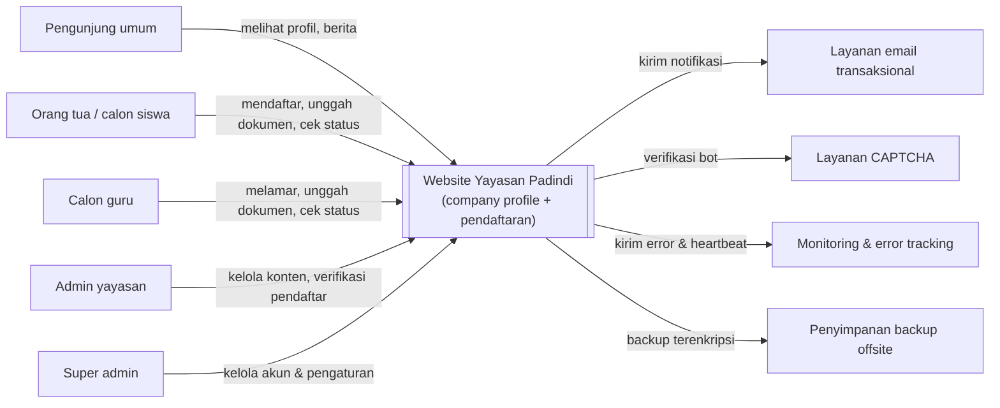
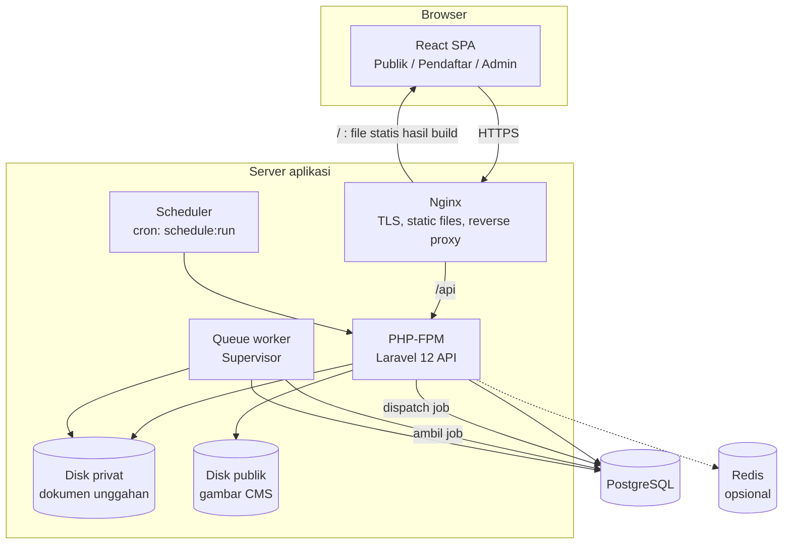
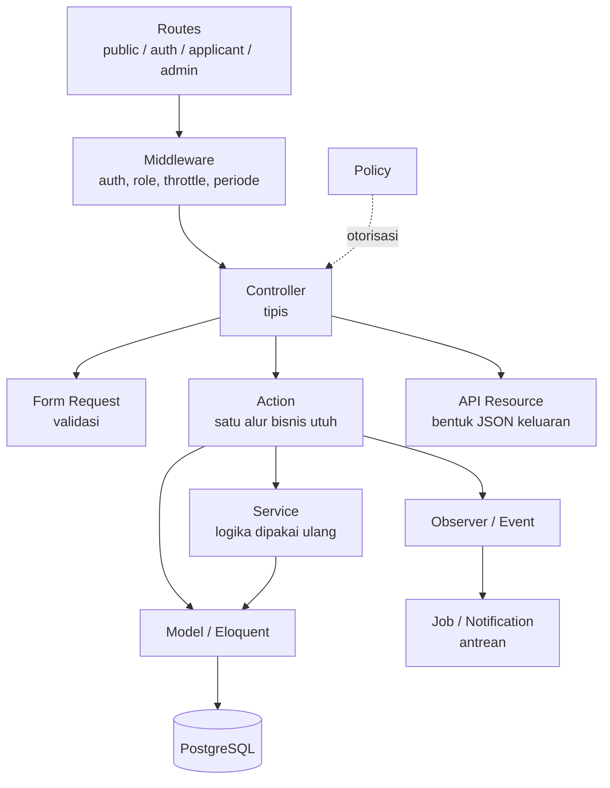
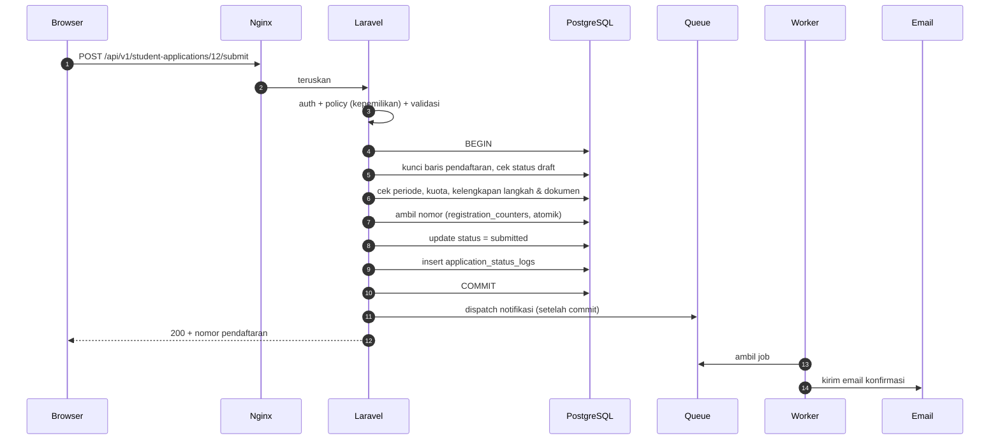
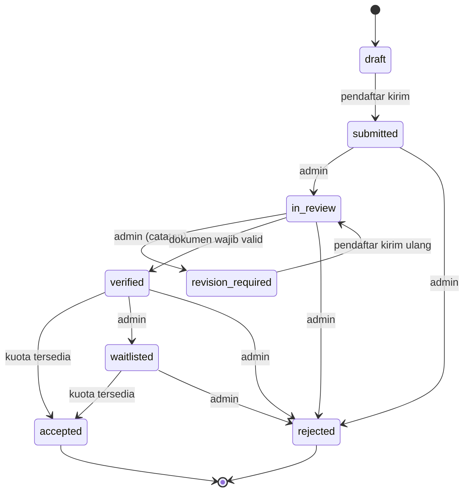
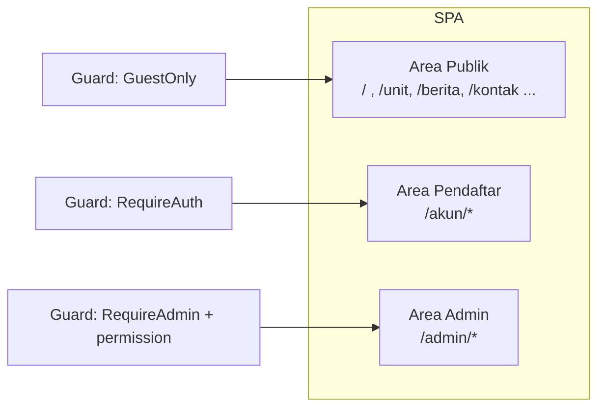
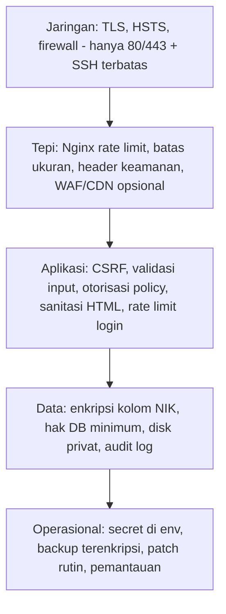
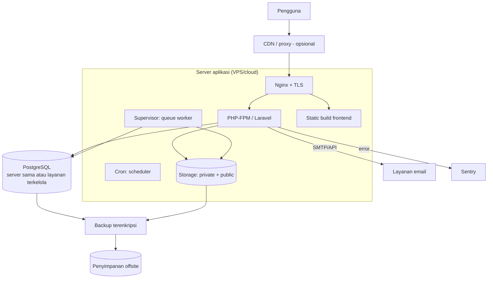
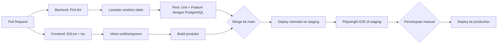

# ARCHITECTURE — Website Yayasan Padindi

| | |
|---|---|
| **Versi** | 0.1 (Draft) |
| **Dokumen terkait** | `PRD-Website-Yayasan-Padindi.md`, `Skema-Database-Padindi.md` + `schema-padindi.sql`, `Struktur-Folder-Padindi.md`, `Rancangan-API-Padindi.md` |
| **Status** | Menunggu review tim teknis dan persetujuan stakeholder |

> Teks dalam `[...]` adalah placeholder atau usulan yang perlu dikonfirmasi. Dokumen ini menjelaskan **bagaimana sistem disusun dan mengapa**. Detail kolom tabel, endpoint, dan struktur folder ada di dokumen terkait.

---

## Daftar Isi

1. [Ringkasan](#1-ringkasan)
2. [Tujuan Arsitektur & Atribut Kualitas](#2-tujuan-arsitektur--atribut-kualitas)
3. [Konteks Sistem](#3-konteks-sistem)
4. [Gambaran Kontainer](#4-gambaran-kontainer)
5. [Arsitektur Backend](#5-arsitektur-backend)
6. [Arsitektur Frontend](#6-arsitektur-frontend)
7. [Arsitektur Data](#7-arsitektur-data)
8. [Autentikasi & Otorisasi](#8-autentikasi--otorisasi)
9. [Penyimpanan Berkas](#9-penyimpanan-berkas)
10. [Pemrosesan Asinkron & Terjadwal](#10-pemrosesan-asinkron--terjadwal)
11. [Caching & Performa](#11-caching--performa)
12. [Arsitektur Keamanan & Privasi](#12-arsitektur-keamanan--privasi)
13. [Strategi SEO](#13-strategi-seo)
14. [Arsitektur Deployment](#14-arsitektur-deployment)
15. [CI/CD & Alur Kerja Pengembangan](#15-cicd--alur-kerja-pengembangan)
16. [Observabilitas & Operasional](#16-observabilitas--operasional)
17. [Backup & Pemulihan Bencana](#17-backup--pemulihan-bencana)
18. [Strategi Pengujian](#18-strategi-pengujian)
19. [Catatan Keputusan Arsitektur (ADR)](#19-catatan-keputusan-arsitektur-adr)
20. [Risiko Teknis & Utang Teknis](#20-risiko-teknis--utang-teknis)
21. [Jalur Evolusi](#21-jalur-evolusi)
22. [Pertanyaan Terbuka](#22-pertanyaan-terbuka)

---

## 1. Ringkasan

Sistem terdiri dari dua aplikasi dalam satu repositori (monorepo):

- **Backend**: Laravel 12 sebagai REST API, satu-satunya pemilik logika bisnis, validasi, dan akses data.
- **Frontend**: React + Vite + TypeScript sebagai SPA, memuat tiga area: situs publik (company profile), area pendaftar, dan panel admin.
- **Database**: PostgreSQL.

Pendekatan yang dipilih adalah **monolit modular**: satu aplikasi backend yang dipisah rapi per area tanggung jawab, bukan microservices. Alasannya: skala yayasan pendidikan tunggal, tim kecil, kebutuhan operasional sederhana, dan lonjakan beban yang terprediksi (musim pendaftaran). Monolit yang disiplin lebih murah dibangun, diuji, dan dirawat, dan tetap bisa dipecah kelak bila dibutuhkan (lihat bagian 21).

## 2. Tujuan Arsitektur & Atribut Kualitas

Urutan prioritas, dari yang paling memengaruhi keputusan desain:

| Prioritas | Atribut | Penjabaran | Keputusan yang dipengaruhi |
|---|---|---|---|
| 1 | **Keamanan & privasi data** | Data anak dan keluarga (NIK, dokumen identitas), tunduk pada UU PDP | Enkripsi kolom NIK, disk privat, otorisasi per baris, audit log, backup terenkripsi |
| 2 | **Keandalan saat musim pendaftaran** | Lonjakan akses saat periode dibuka; kegagalan di fase ini berdampak langsung pada yayasan | Antrean untuk pekerjaan berat, caching halaman publik, indeks database, uji beban |
| 3 | **Kemudahan perawatan** | Tim kecil, kemungkinan pergantian developer | Monolit modular, lapisan jelas, konvensi kode, pengujian otomatis, dokumentasi |
| 4 | **Kesederhanaan operasional** | Yayasan tidak memiliki tim DevOps | Topologi minimal, tool terkelola bila memungkinkan, deployment otomatis |
| 5 | **Kegunaan di perangkat seluler** | Mayoritas orang tua memakai ponsel | Mobile-first, bundle ringan, formulir bertahap dengan simpan draft |
| 6 | **Keterlacakan** | Setiap perubahan status harus bisa dipertanggungjawabkan | Log status, log aktivitas admin |
| 7 | **Keterbacaan mesin pencari** | Company profile harus mudah ditemukan | Pre-render halaman publik |

**Non-tujuan (fase ini):** skala multi-yayasan (multi-tenant), ketersediaan tinggi lintas wilayah, integrasi pembayaran, aplikasi mobile native.

## 3. Konteks Sistem

Sistem eksternal yang disentuh pada fase ini hanya empat: email, CAPTCHA, monitoring, dan penyimpanan backup. Tidak ada integrasi dengan sistem akademik atau pembayaran.

## 4. Gambaran Kontainer

| Kontainer | Tanggung jawab |
|---|---|
| **React SPA** | Antarmuka tiga area. Tidak memuat logika bisnis yang tidak dapat dipercaya; semua aturan ditegakkan ulang di server |
| **Nginx** | Terminasi TLS, melayani build frontend, meneruskan `/api` ke PHP-FPM, header keamanan, pembatasan laju lapis pertama, batas ukuran unggahan |
| **Laravel API** | Autentikasi, otorisasi, validasi, aturan bisnis, akses data, pembuatan PDF/ekspor |
| **Queue worker** | Mengirim email, memproses gambar, pekerjaan terjadwal berat, dengan percobaan ulang otomatis |
| **Scheduler** | Pekerjaan berkala (retensi data, pembersihan, dsb.) |
| **PostgreSQL** | Satu-satunya sumber kebenaran data terstruktur |
| **Disk privat / publik** | Berkas dokumen sensitif (tidak pernah publik) dan gambar konten CMS (publik) |
| **Redis (opsional)** | Cache, rate limiter, dan antrean saat beban meningkat. Tidak wajib di tahap awal |

**Satu origin.** Frontend dan API dilayani dari domain yang sama (`https://[domain]/` dan `https://[domain]/api`). Ini menghilangkan kerumitan CORS dan membuat cookie sesi Sanctum sederhana (ADR-003).

## 5. Arsitektur Backend

### 5.1 Pola: Monolit Modular Berlapis

Aturan ketergantungan (arah panah tidak boleh dibalik):

1. Controller hanya mengorkestrasi: menerima request, memanggil Action, mengembalikan Resource.
2. **Action** menjalankan satu alur bisnis dalam satu transaksi (mis. `SubmitStudentApplication`).
3. **Service** berisi logika yang dipakai banyak Action dan tidak mengenal HTTP (`QuotaService`, `ApplicationStatusService`, `RegistrationNumberGenerator`).
4. **Model** menyimpan relasi, cast, dan scope. Tidak memuat alur bisnis.
5. **Resource** adalah satu-satunya tempat menentukan bentuk data keluar, termasuk penyamaran NIK.

### 5.2 Pembagian Area (Modul)

| Modul | Cakupan | Tabel utama | Bergantung pada |
|---|---|---|---|
| **Identity & Access** | Registrasi, login, role, permission, verifikasi email | `users`, `roles`, `permissions` | n/a |
| **Public Content (CMS)** | Halaman, berita, galeri, banner, organisasi, pengaturan, pesan kontak | `posts`, `pages`, `galleries`, `banners`, `organization_members`, `settings`, `contact_messages` | Identity |
| **Catalog** | Unit pendidikan, periode, kuota, syarat dokumen, lowongan | `education_units`, `registration_periods`, `period_unit_quotas`, `document_requirements`, `teacher_vacancies` | Identity |
| **Student Registration** | Draft, langkah formulir, kirim, revisi, status | `student_applications`, `students`, `guardians` | Catalog, Documents, Audit |
| **Teacher Registration** | Setara untuk guru | `teacher_applications`, `teacher_educations`, `teacher_experiences`, `teacher_certifications` | Catalog, Documents, Audit |
| **Documents** | Unggah, verifikasi, unduh terotorisasi | `documents` | Identity |
| **Audit** | Riwayat status dan log aktivitas | `application_status_logs`, `activity_logs` | Identity |

Modul masih berada dalam satu codebase dan satu database, tetapi **tidak saling menembus**: modul Registration memanggil Catalog lewat Service/query terdefinisi, bukan menulis ke tabel Catalog. Aturan ini menjaga kemungkinan memecah modul di masa depan.

### 5.3 Siklus Request: Kirim Pendaftaran

Poin penting: notifikasi di-dispatch **setelah commit** (`afterCommit`), sehingga email tidak terkirim untuk transaksi yang batal, dan respons ke pengguna tidak menunggu pengiriman email.

### 5.4 Mesin Status

Transisi status dikendalikan satu tempat (`ApplicationStatusService`) dengan peta transisi pada Backed Enum. Database menjamin nilai valid dan kelengkapan nomor pendaftaran (CHECK constraint), aplikasi menjamin urutan dan hak.

Alur guru lebih pendek (`draft → submitted → administrative_review → interview_test → passed | failed | reserve`); lihat Rancangan API bagian 12.

### 5.5 Konkurensi dan Integritas

| Risiko | Penanganan |
|---|---|
| Dua pendaftar mendapat nomor sama | `registration_counters` dengan `INSERT ... ON CONFLICT DO UPDATE ... RETURNING`, di dalam transaksi |
| Kuota terlampaui saat dua admin menerima bersamaan | Penguncian baris (`SELECT ... FOR UPDATE`) pada baris kuota unit/periode di dalam transaksi |
| Pendaftar menekan "Kirim" dua kali | Pemeriksaan status di bawah kunci baris membuat permintaan kedua gagal dengan `APPLICATION_NOT_EDITABLE`; tombol di frontend dinonaktifkan selama proses |
| Dua admin mengubah pendaftaran yang sama | Perubahan status memeriksa status asal terakhir di dalam transaksi; yang kalah menerima `INVALID_STATUS_TRANSITION` |
| Berkas yatim (record hilang tetapi berkas ada, atau sebaliknya) | Simpan berkas dulu, lalu record dalam transaksi; bila gagal, hapus berkas. Job pembersihan berkala memindai berkas tanpa record |

### 5.6 Penanganan Error

- Handler terpusat di `bootstrap/app.php` memetakan exception ke format error standar (`message`, `code`, `errors`).
- Exception domain (mis. `RegistrationClosedException`, `InvalidStatusTransitionException`) membawa `code` dan status HTTP sendiri.
- Pada produksi, detail internal tidak pernah dikirim ke klien; semuanya masuk log dan Sentry dengan `request_id`.
- Setiap respons menyertakan header `X-Request-Id` untuk memudahkan penelusuran laporan pengguna.

## 6. Arsitektur Frontend

### 6.1 Tiga Area dalam Satu SPA

- Setiap area dimuat dengan **code splitting** (lazy route), sehingga pengunjung publik tidak mengunduh kode admin.
- Layout terpisah per area (`PublicLayout`, `ApplicantLayout`, `AdminLayout`, `AuthLayout`).
- Organisasi kode **berbasis fitur** (lihat Struktur Folder bagian 3).

### 6.2 Manajemen State

| Jenis state | Alat | Aturan |
|---|---|---|
| **Server state** (data dari API) | TanStack Query | Sumber kebenaran tunggal untuk data server; tidak disalin ke store global |
| **State formulir** | React Hook Form + Zod | Skema Zod menjadi sumber tipe TypeScript dan validasi sisi klien |
| **State sesi pengguna** | Query `GET /auth/me` | Diambil saat aplikasi dimuat; guard rute membaca hasilnya |
| **State UI lokal** | `useState` / `useReducer` | Dimiliki komponen yang memakainya |
| **State global UI** (toast, modal) | Context ringan | Dipakai seminimal mungkin |

Tidak memakai store global (Redux/Zustand) pada tahap ini karena hampir seluruh state berasal dari server. Jika kebutuhan muncul, tambahkan secara terbatas.

Konvensi *query key*: `[fitur, sumber daya, parameter]`, contoh `['student-applications', 'detail', id]`. Mutasi menginvalidasi key yang terdampak.

### 6.3 Klien API (`lib/api-client.ts`)

Satu instance Axios/Fetch dengan perilaku terpusat:

| Respons | Penanganan terpusat |
|---|---|
| `401` | Bersihkan cache sesi, arahkan ke login dengan `returnTo` |
| `419` | Ambil ulang cookie CSRF lalu ulangi request satu kali |
| `422` | Petakan `errors` ke field React Hook Form |
| `429` | Tampilkan pesan batas laju, hormati `Retry-After` |
| `409` + `code` | Dikembalikan ke pemanggil untuk pesan khusus (mis. `REGISTRATION_CLOSED`) |
| `5xx` / jaringan | Pesan umum + tombol coba lagi; request idempoten dicoba ulang otomatis oleh Query |

### 6.4 Pola Formulir Pendaftaran

- Formulir **bertahap**; setiap langkah disimpan ke server lewat `PUT .../steps/{n}`, sehingga draft tersimpan walau browser ditutup.
- Penyimpanan otomatis saat pindah langkah (bukan setiap ketikan) agar hemat permintaan dan tidak memicu rate limit.
- Posisi terakhir dipulihkan dari `current_step`.
- Unggah dokumen: kompres/ubah ukuran gambar di sisi klien sebelum unggah (menghemat kuota data orang tua), tampilkan progres, dan jelaskan error spesifik (ukuran/tipe).
- Validasi klien hanya untuk kenyamanan; validasi otoritatif di server.
- Peringatan non-fatal dari server (`warnings`, mis. kemungkinan NIK ganda) ditampilkan sebagai pemberitahuan, tidak memblokir.

### 6.5 Build dan Pengiriman

- Vite menghasilkan aset ber-hash (cache panjang `immutable`); `index.html` tidak di-cache.
- Variabel lingkungan hanya `VITE_*` dan tidak boleh berisi rahasia (semua terlihat publik).
- Target: LCP ≤ 2,5 detik pada 4G untuk halaman publik; pantau lewat Lighthouse CI [opsional].
- Gambar: format modern (WebP/AVIF) dengan `srcset`, `loading="lazy"`, dimensi eksplisit untuk mencegah pergeseran tata letak.
- Aksesibilitas: komponen dasar mengikuti WCAG 2.1 AA (label, fokus, kontras, navigasi keyboard).

## 7. Arsitektur Data

Rincian lengkap ada di `Skema-Database-Padindi.md`. Ringkasan keputusan arsitektural:

| Keputusan | Alasan |
|---|---|
| Satu database PostgreSQL, satu skema aplikasi | Skala dan kebutuhan transaksi (kuota, nomor) cocok untuk RDBMS tunggal |
| Enum sebagai `varchar` + `CHECK` | Mudah diubah lewat migration tanpa menyentuh tipe enum |
| Soft delete + *partial unique index* | Slug dan email dapat dipakai ulang; data pendaftaran tidak hilang tak sengaja |
| Relasi polimorfik untuk `documents` dan `application_status_logs` | Satu mekanisme untuk siswa dan guru; dibatasi `CHECK` dan morph map |
| `nik` terenkripsi + `nik_hash` | Melindungi data pada level aplikasi sambil tetap memungkinkan deteksi duplikat |
| `jsonb` hanya untuk data semi-terstruktur non-relasional (fasilitas, program unit, properti log) | Data yang dicari/diikat relasi tetap kolom biasa |
| Indeks trigram untuk pencarian nama | Pencarian admin cepat tanpa mesin pencari terpisah |
| Migration sebagai satu-satunya jalur perubahan skema | Perubahan terlacak di Git; berkas `schema-padindi.sql` menjadi acuan desain, bukan alat deployment |

**Koneksi database:** pengguna aplikasi memakai hak minimum (DML pada skema aplikasi; tidak punya hak superuser). Pengguna migration terpisah dengan hak DDL, dipakai hanya saat deployment.

## 8. Autentikasi & Otorisasi

| Aspek | Desain |
|---|---|
| Mekanisme | Laravel Sanctum mode SPA (sesi berbasis cookie + token CSRF) |
| Cookie | `HttpOnly`, `Secure`, `SameSite=Lax`; kedaluwarsa sesi [120 menit tidak aktif; konfirmasi] |
| Jenis akun | `applicant` dan `admin`, login terpisah (`/auth/login`, `/auth/admin/login`) |
| Otorisasi admin | Role + permission granular (`can:<permission>` per rute) |
| Otorisasi data pendaftar | Policy berbasis kepemilikan; akses ke data orang lain mengembalikan 404 |
| Sesi admin | Disarankan masa aktif lebih pendek dan 2FA [prioritas Should] |
| Pemulihan akun | Tautan reset berumur pendek, sekali pakai, respons seragam |
| Perlindungan brute force | Rate limit per IP+email, penundaan eksponensial, log percobaan gagal |

Keputusan tidak memakai token bearer (JWT) untuk SPA: cookie `HttpOnly` tidak dapat dibaca JavaScript sehingga tahan terhadap pencurian token lewat XSS, dan Laravel mengelola siklus hidupnya.

## 9. Penyimpanan Berkas

| Jenis | Disk | Akses | Contoh |
|---|---|---|---|
| **Dokumen pendaftar** (akta, KK, ijazah, CV) | `private` (di luar webroot) | Hanya lewat endpoint terotorisasi atau URL bertanda tangan berumur pendek | `storage/app/private/documents/...` |
| **Gambar CMS** (sampul berita, galeri, logo, banner) | `public` | Publik, dilayani Nginx langsung | `storage/app/public/...` |

Prinsip:

- Semua akses lewat abstraksi **Laravel Filesystem**, sehingga pindah ke penyimpanan objek S3-compatible hanya perubahan konfigurasi.
- Nama berkas diacak (UUID); nama asli disimpan di database saja. Struktur direktori tidak memuat data pribadi.
- Validasi MIME berdasarkan isi berkas, bukan ekstensi; berkas tidak pernah dieksekusi (Nginx tidak menjalankan PHP di direktori unggahan).
- Gambar CMS diproses worker (resize, konversi WebP, thumbnail).
- Dokumen yang diganti pendaftar di-*soft delete*; job retensi menghapus fisik setelah masa yang disepakati.
- Pemindaian virus (ClamAV) dapat dipasang sebagai langkah opsional pada pipeline unggah [pertimbangkan sesuai anggaran].

## 10. Pemrosesan Asinkron & Terjadwal

### 10.1 Antrean

| Aspek | Tahap awal | Saat beban naik |
|---|---|---|
| Driver | `database` (tanpa komponen tambahan) | `redis` |
| Worker | 1-2 proses di bawah Supervisor | Tambah proses, pisahkan antrean `default` dan `mail` |
| Percobaan ulang | 3 kali dengan backoff | Sama |
| Job gagal | Tabel `failed_jobs` + peringatan ke Sentry | Sama |

Job: `SendApplicationStatusNotification`, `ApplicationSubmittedNotification`, pemrosesan gambar CMS, `PurgeExpiredApplicantData`, dan `GenerateApplicationsExport` (hanya jika ekspor dijadikan asinkron).

Semua job idempoten (aman dijalankan ulang) dan di-dispatch `afterCommit`.

### 10.2 Pekerjaan Terjadwal (`routes/console.php`)

| Jadwal | Pekerjaan |
|---|---|
| Harian | `PurgeExpiredApplicantData` (retensi UU PDP), pembersihan berkas yatim, pemangkasan token/sesi kedaluwarsa |
| Harian | Pemangkasan `failed_jobs` lama dan batch selesai |
| Per jam | Penutupan/pembukaan otomatis periode (bila diperlukan di luar pengecekan saat request) |
| Mingguan | Laporan ringkas ke admin [opsional] |

Scheduler dijalankan satu entri cron per menit (`php artisan schedule:run`) pada satu server saja.

## 11. Caching & Performa

### 11.1 Lonjakan Beban Saat Pendaftaran

Profil beban tidak merata: sebagian besar waktu sepi, lalu melonjak saat periode dibuka dan mendekati batas akhir. Strategi berlapis:

| Lapisan | Teknik |
|---|---|
| **Statis** | Frontend hasil build dilayani Nginx; aset ber-hash dengan cache panjang. CDN/proxy (mis. Cloudflare) di depan origin [opsional, sangat dianjurkan] |
| **Endpoint publik** | Header `Cache-Control` + ETag; cache sisi server dengan TTL pendek (5-15 menit), diinvalidasi saat konten diubah |
| **Database** | Indeks sesuai pola kueri (lihat dokumen skema); mencegah N+1 dengan eager loading; paginasi wajib pada daftar |
| **Pekerjaan berat** | Email, gambar, ekspor besar di luar siklus request |
| **PHP-FPM** | Jumlah worker disetel terhadap memori; OPcache aktif; `config:cache`, `route:cache`, `event:cache`, `view:cache` pada deployment |
| **Perlindungan** | Rate limit di Nginx dan Laravel; batas ukuran unggahan; batas `per_page` maksimum 100 |

Catatan: cache *tags* Laravel tidak didukung driver `file` dan `database`. Jika invalidasi per kelompok diperlukan, gunakan Redis atau kunci cache berversi. Karena itu Redis menjadi komponen pertama yang ditambahkan bila beban menuntut.

### 11.2 Pengukuran

- Uji beban (k6/JMeter) pada staging **sebelum** setiap musim pendaftaran, dengan skenario: ribuan pengunjung publik, ratusan pendaftar mengisi formulir dan mengunggah dokumen bersamaan, admin memfilter dan mengekspor.
- Target awal (usulan, menunggu estimasi jumlah pendaftar): respons API umum p95 ≤ 500 ms; unggahan berkas 2 MB selesai ≤ 5 detik pada 4G.
- Penentuan ukuran server akhir menunggu angka target pendaftar per periode (lihat pertanyaan terbuka).

## 12. Arsitektur Keamanan & Privasi

### 12.1 Lapisan Pertahanan

### 12.2 Batas Kepercayaan dan Ancaman Utama

| Ancaman | Kontrol |
|---|---|
| Pendaftar mengakses data pendaftar lain (IDOR) | Policy kepemilikan di setiap endpoint; respons 404; uji otomatis khusus lintas-pengguna |
| Pencurian sesi via XSS | Cookie `HttpOnly`; CSP ketat; sanitasi HTML konten CMS di server; tidak merender HTML mentah di frontend |
| CSRF | Token CSRF Sanctum + `SameSite=Lax` |
| Unggah berkas berbahaya | Validasi MIME isi, nama diacak, disk di luar webroot, tidak ada eksekusi skrip di direktori unggahan, pemindaian virus opsional |
| Injeksi SQL | Eloquent/query terparameter; larangan SQL mentah tanpa binding (ditegakkan lewat review dan analisis statis) |
| Brute force & credential stuffing | Rate limit per IP+email, CAPTCHA, kebijakan kata sandi, log percobaan gagal, 2FA admin (Should) |
| Enumerasi akun | Respons login/reset seragam; 404 untuk data bukan milik sendiri |
| Spam formulir publik | CAPTCHA, rate limit, honeypot [opsional] |
| Kebocoran lewat log | Penyamaran data pribadi di log; NIK dan kata sandi tidak pernah dicatat |
| Penyalahgunaan akun admin | Permission granular, audit trail, nonaktifkan akun, minimal satu Super Admin aktif |
| Rantai pasok (dependensi) | `composer audit`, `npm audit`, Dependabot/Renovate, kunci versi (`composer.lock`, `package-lock.json`) |
| Kebocoran rahasia | `.env` di luar Git, rahasia CI di secret store, pemindaian rahasia pada repo |

### 12.3 Header Keamanan (Nginx)

`Strict-Transport-Security`, `Content-Security-Policy` (sumber skrip/gambar dibatasi ke origin sendiri dan layanan CAPTCHA), `X-Content-Type-Options: nosniff`, `Referrer-Policy: strict-origin-when-cross-origin`, `Permissions-Policy` minimal, `X-Frame-Options: DENY`.

### 12.4 Pelindungan Data Pribadi (UU PDP)

| Prinsip | Implementasi |
|---|---|
| Persetujuan eksplisit | `consent_accepted_at` dan `declaration_accepted_at` tersimpan per pendaftaran; teks persetujuan melibatkan orang tua/wali untuk data anak |
| Tujuan dan minimisasi | Hanya kolom yang dibutuhkan proses pendaftaran; data opsional (mis. penghasilan) hanya bila yayasan mewajibkan |
| Pembatasan akses | Permission `applications.view_sensitive`; NIK tersamar di daftar admin |
| Keamanan data | Enkripsi kolom NIK, HTTPS, disk privat, backup terenkripsi |
| Retensi dan penghapusan | Job `PurgeExpiredApplicantData` sesuai masa retensi [ditetapkan yayasan] |
| Keterlacakan | `activity_logs` untuk akses/ekspor/ubah oleh admin |
| Respons insiden | Prosedur tertulis: deteksi, isolasi, penilaian, pemberitahuan ke pihak berwenang dan subjek data bila disyaratkan [disusun bersama yayasan/konsultan hukum] |

Penafsiran hukum dan kewajiban pasti (mis. penunjukan pejabat pelindungan data, batas waktu pemberitahuan insiden) perlu ditinjau konsultan hukum yayasan; dokumen ini hanya menerjemahkan prinsipnya ke kontrol teknis.

### 12.5 Pengelolaan Rahasia dan Konfigurasi

- Seluruh rahasia (`APP_KEY`, kredensial DB, SMTP, kunci CAPTCHA) hanya di variabel lingkungan server dan secret CI.
- `APP_KEY` dipakai untuk enkripsi NIK; **kehilangan atau rotasi tanpa prosedur membuat data terenkripsi tak terbaca**. Simpan salinan aman di luar server dan siapkan prosedur rotasi (enkripsi ulang bertahap).
- `APP_DEBUG=false` dan `APP_ENV=production` di produksi.

## 13. Strategi SEO

Halaman publik harus dapat diindeks, sementara area pendaftar dan admin tidak perlu.

| Area | Strategi |
|---|---|
| Rute statis publik (beranda, tentang, visi misi, unit, informasi pendaftaran, kontak, kebijakan privasi) | **Pre-render saat build**: HTML penuh dihasilkan untuk setiap rute |
| Berita dan detail konten dinamis | Opsi (a) pre-render ulang terjadwal/dipicu publikasi; opsi (b) SSR ringan untuk rute `/berita/*`. Mulai dengan (a) |
| Meta tag | Komponen `SeoHead` per halaman (title, description, Open Graph, canonical) dari data CMS |
| Sitemap & robots | `sitemap.xml` dihasilkan dari konten terbit; `robots.txt` memblokir `/admin` dan `/akun` |
| Data terstruktur | JSON-LD `EducationalOrganization` / `School` pada beranda dan unit |
| Area pendaftar dan admin | SPA murni, `noindex` |

Keputusan ini dicatat sebagai ADR-006. Bila kebutuhan SEO meningkat (banyak konten berita dinamis), pindah ke SSR penuh tanpa mengubah struktur API.

## 14. Arsitektur Deployment

### 14.1 Lingkungan

| Lingkungan | Tujuan | Data |
|---|---|---|
| **Local** | Pengembangan | PHP CLI Server (`artisan serve`), PostgreSQL lokal, Vite dev server; data seeder |
| **Staging** | UAT, uji beban, uji rilis | Data sintetis atau hasil anonimisasi; **tidak** memakai data pendaftar asli |
| **Production** | Layanan sebenarnya | Data asli |

### 14.2 Topologi Produksi (Tahap Awal)

**Usulan ukuran awal** (harus divalidasi uji beban dan estimasi pendaftar): 2 vCPU, 4 GB RAM, SSD, Ubuntu LTS, PostgreSQL pada server yang sama. Rekomendasi bila anggaran memungkinkan: **PostgreSQL terkelola** (backup, patching, dan pemulihan titik waktu ditangani penyedia), karena database adalah aset paling berharga.

### 14.3 Konfigurasi Nginx (Gambaran)

- `/` → file statis build frontend, `try_files` ke `index.html` untuk rute SPA (rute yang sudah di-pre-render dilayani langsung).
- `/api` dan `/sanctum` → PHP-FPM Laravel.
- `/storage` → disk publik saja; **disk privat tidak pernah dipetakan**.
- `client_max_body_size` selaras batas unggahan aplikasi (usulan 6 MB).
- Kompresi gzip/brotli, HTTP/2, cache aset ber-hash `immutable`.
- Blokir akses berkas tersembunyi (`.env`, `.git`) dan eksekusi PHP selain `index.php`.

### 14.4 Strategi Rilis

- **Zero-downtime** dengan struktur rilis bertautan simbolik (`releases/`, `shared/`, `current` → rilis aktif), mis. memakai Deployer atau skrip setara.
- Urutan: unggah rilis → `composer install --no-dev --optimize-autoloader` → build/unggah frontend → `artisan migrate --force` → `config:cache` dst. → ganti tautan `current` → `queue:restart` → *smoke test* → selesai.
- **Migration kompatibel mundur**: perubahan destruktif (hapus/ganti nama kolom) dilakukan dua tahap lintas rilis (expand → migrate → contract) agar rilis lama dan baru dapat hidup berdampingan sebentar.
- **Rollback**: ganti tautan `current` ke rilis sebelumnya; migration yang sudah jalan tidak di-rollback otomatis (desain kompatibel mundur memungkinkan ini).
- **Mode pemeliharaan**: `artisan down` dengan halaman informasi hanya untuk perubahan yang tak dapat zero-downtime.
- **Jendela rilis**: hindari rilis pada masa puncak pendaftaran; terapkan *change freeze* sebelum periode dibuka [kebijakan bersama yayasan].

## 15. CI/CD & Alur Kerja Pengembangan

### 15.1 Alur Git

- Cabang utama `main` selalu dapat dirilis. Pengembangan di cabang pendek `feature/*`, `fix/*`, `chore/*` lewat Pull Request.
- Commit mengikuti Conventional Commits. PR wajib lolos CI dan di-review minimal satu orang.
- Rilis ditandai tag versi (`v1.0.0`) mengikuti SemVer.

### 15.2 Pipeline

- Uji backend dijalankan terhadap **PostgreSQL sungguhan** (bukan SQLite), karena skema memakai fitur khusus PostgreSQL (partial index, `jsonb`, trigram, `CHECK`).
- Pemindaian keamanan dependensi (`composer audit`, `npm audit`) pada setiap PR dan terjadwal mingguan.
- Deploy ke production **dengan persetujuan manual** dan dapat dipicu dari tag rilis.

## 16. Observabilitas & Operasional

| Aspek | Rancangan |
|---|---|
| **Log aplikasi** | Format JSON terstruktur, `request_id` pada setiap baris, rotasi harian, retensi [30] hari. Data pribadi disamarkan |
| **Pelacakan error** | Sentry (backend dan frontend) dengan peringatan ke tim; *source map* frontend diunggah saat rilis |
| **Health check** | Endpoint bawaan Laravel `/up` untuk keberadaan aplikasi; endpoint internal terautentikasi untuk memeriksa koneksi DB, antrean, dan ruang disk |
| **Uptime** | Pemantau eksternal (mis. UptimeRobot) pada beranda, `/up`, dan satu endpoint API publik |
| **Metrik server** | CPU, memori, disk, koneksi PostgreSQL, kedalaman antrean, jumlah job gagal |
| **Peringatan** | Situs mati, error 5xx melonjak, antrean menumpuk, disk > 80%, backup gagal, sertifikat TLS mendekati kedaluwarsa |
| **Audit bisnis** | `application_status_logs` dan `activity_logs` (bukan pengganti log teknis) |
| **Runbook** | Dokumen langkah penanganan insiden umum: situs lambat, antrean macet, disk penuh, rollback rilis, restore backup |

## 17. Backup & Pemulihan Bencana

| Aset | Metode | Frekuensi | Retensi (usulan) |
|---|---|---|---|
| PostgreSQL | `pg_dump` terkompresi dan terenkripsi (atau snapshot/PITR layanan terkelola) | Harian; lebih sering saat periode pendaftaran | 30 harian + 12 bulanan |
| Dokumen unggahan (disk privat) | Sinkronisasi inkremental terenkripsi ke penyimpanan offsite | Harian | Mengikuti retensi data pendaftar |
| Gambar CMS | Sama dengan di atas | Harian | 30 hari |
| Konfigurasi dan rahasia | Salinan aman di luar server (termasuk `APP_KEY`) | Setiap perubahan | n/a |
| Kode | Git (repo jarak jauh) | Setiap push | n/a |

**Target pemulihan (usulan, disepakati dengan yayasan):**

- **RPO** (maksimum data hilang): 24 jam; ingin lebih ketat saat musim pendaftaran, pertimbangkan arsip WAL atau PITR.
- **RTO** (waktu pemulihan layanan): 4 jam.

**Aturan:**

- Backup disimpan **terpisah dari server utama** (penyedia/akun berbeda) dan terenkripsi.
- **Uji pemulihan** terjadwal (minimal per kuartal dan sebelum musim pendaftaran): pulihkan ke lingkungan terpisah, verifikasi data dan berkas bisa dibaca (termasuk dekripsi NIK dengan `APP_KEY`).
- Backup yang belum pernah diuji dianggap belum ada.
- Penghapusan data atas permintaan subjek data atau retensi harus memperhitungkan salinan backup (daur hidup backup selaras kebijakan retensi).

## 18. Strategi Pengujian

| Tingkat | Fokus | Alat | Catatan |
|---|---|---|---|
| Unit (backend) | Service, enum, peta transisi, generator nomor | Pest | Cepat, tanpa DB bila bisa |
| Feature (backend) | Endpoint, validasi, otorisasi, aturan bisnis | Pest + PostgreSQL | Wajib mencakup: akses lintas pengguna, status tidak sah, periode tutup, kuota, kelengkapan dokumen, penyamaran NIK |
| Konkurensi | Nomor ganda, kuota, kirim ganda | Pest (proses paralel) / skrip khusus | Menguji kunci baris dan atomisitas |
| Unit/komponen (frontend) | Komponen formulir, validasi Zod, guard | Vitest + Testing Library | |
| End-to-end | Alur utama: daftar akun → isi formulir → unggah → kirim → admin verifikasi → status berubah | Playwright | Berjalan di staging |
| Beban | Lonjakan pendaftaran | k6/JMeter | Sebelum musim pendaftaran |
| Keamanan | OWASP Top 10 dasar, IDOR, unggah berkas, header | Daftar periksa manual + pemindai | Sebelum go-live dan tiap perubahan besar |
| Aksesibilitas | WCAG 2.1 AA halaman publik dan formulir | axe + uji manual | |
| UAT | Skenario nyata oleh perwakilan yayasan | Skenario tertulis | Syarat penerimaan proyek |

Target cakupan (usulan): ≥ 80% pada Service/Action inti; pengujian otorisasi bersifat wajib untuk setiap endpoint baru.

## 19. Catatan Keputusan Arsitektur (ADR)

Format ringkas: konteks, keputusan, konsekuensi. Status semua: **Diusulkan** (menunggu persetujuan).

| ID | Keputusan | Alasan | Konsekuensi / Pertukaran |
|---|---|---|---|
| **ADR-001** | **Monorepo** dengan `backend/`, `frontend/`, `docs/` | Satu tim kecil, perubahan API dan UI sering bersamaan, satu tempat dokumentasi | CI perlu pemisahan job per bagian; repo membesar seiring waktu |
| **ADR-002** | **Laravel API + React SPA** (bukan Blade/Inertia) | Stack ditetapkan klien; API bersih membuka jalan bagi klien lain; UI interaktif untuk formulir bertahap dan panel admin | Dua aplikasi untuk dirawat; SEO butuh penanganan khusus (ADR-006) |
| **ADR-003** | **Sanctum SPA (cookie) + satu origin** | Cookie `HttpOnly` lebih aman dari token di storage; satu origin menghilangkan CORS dan masalah cookie lintas domain | Frontend dan API harus berbagi domain; klien non-browser perlu mekanisme token tambahan kelak |
| **ADR-004** | **PostgreSQL** | Stack ditetapkan; mendukung partial index, `jsonb`, trigram, transaksi kuat untuk kuota | Beberapa fitur (partial index, trigram) butuh `DB::statement` di migration |
| **ADR-005** | **Enum = `varchar` + `CHECK`** | Mudah diubah lewat migration; enum native PostgreSQL sulit diubah | Nilai harus disinkronkan dengan Backed Enum PHP (ditegakkan lewat uji) |
| **ADR-006** | **Pre-render halaman publik; area lain SPA murni** | SEO company profile tanpa kompleksitas SSR penuh | Konten dinamis baru muncul di HTML statis setelah pre-render ulang; SSR dipertimbangkan bila konten berita membesar |
| **ADR-007** | **Dokumen di disk privat, diakses lewat endpoint terotorisasi** | Dokumen identitas anak tidak boleh dapat ditebak/diakses lewat URL | Pengunduhan melalui PHP (lebih berat daripada file statis); dapat dioptimalkan dengan `X-Accel-Redirect` Nginx |
| **ADR-008** | **Antrean driver `database` dulu, Redis menyusul** | Mengurangi komponen di tahap awal | Throughput terbatas; migrasi ke Redis mudah (konfigurasi) saat dibutuhkan |
| **ADR-009** | **Enkripsi NIK di level aplikasi + `nik_hash`** | Melindungi data walau database/backup bocor; tetap bisa cek duplikat | NIK tidak bisa dicari parsial; `APP_KEY` menjadi aset kritis |
| **ADR-010** | **Ekspor sinkron (streaming) dulu** | Sederhana; volume diperkirakan moderat | Bila volume besar, tambah tabel `exports` dan pola asinkron |
| **ADR-011** | **Frontend berbasis fitur, server state di TanStack Query** | Mudah dicari dan dirawat; menghindari duplikasi state | Disiplin diperlukan agar fitur tidak saling mengimpor |
| **ADR-012** | **Soft delete + partial unique index** | Mencegah kehilangan data tak sengaja; slug/email dapat dipakai ulang | Query harus konsisten memakai scope soft delete; data perlu retensi/purge terjadwal |
| **ADR-013** | **Monolit modular, bukan microservices** | Skala dan tim tidak membenarkan kompleksitas operasional | Disiplin batas modul diperlukan agar bisa dipecah kelak |
| **ADR-014** | **Pengujian backend terhadap PostgreSQL asli** | Skema memakai fitur khusus PostgreSQL | CI sedikit lebih lambat; hasil lebih bisa dipercaya |

## 20. Risiko Teknis & Utang Teknis

| # | Risiko / utang | Dampak | Mitigasi |
|---|---|---|---|
| T1 | Lonjakan beban melebihi kapasitas server tunggal | Situs lambat/gagal saat pendaftaran | Uji beban, caching, CDN, antrean, rencana naik kelas (Redis, pisah DB, tambah worker) |
| T2 | Kehilangan atau salah rotasi `APP_KEY` | Data NIK tak terbaca | Salinan aman di luar server, prosedur rotasi terdokumentasi, uji restore termasuk dekripsi |
| T3 | Backup tidak pernah diuji | Gagal pulih saat dibutuhkan | Uji restore terjadwal |
| T4 | SPA kurang optimal untuk SEO | Situs sulit ditemukan | Pre-render (ADR-006), pantau indeks di Search Console |
| T5 | Server tunggal = *single point of failure* | Downtime bila server bermasalah | Backup + runbook + RTO disepakati; HA ditunda sampai ada kebutuhan dan anggaran |
| T6 | Scope creep (pembayaran, akademik) memaksa arsitektur berubah | Biaya dan jadwal naik | Kendalikan lewat PRD; modul sudah dibatasi agar penambahan tidak merusak yang lama |
| T7 | Dependensi usang/rentan | Celah keamanan | Pemindaian otomatis, pembaruan rutin terjadwal |
| T8 | Ketergantungan pada satu developer | Pengetahuan hilang bila berganti | Dokumentasi di `docs/`, ADR, runbook, README per bagian, konvensi kode |
| T9 | Penyimpanan lokal untuk dokumen tumbuh besar | Disk penuh | Pantau disk, kompres gambar di klien, retensi, siap migrasi ke object storage |
| T10 | Kepatuhan UU PDP belum ditinjau hukum | Risiko hukum | Tinjauan konsultan hukum sebelum go-live |

## 21. Jalur Evolusi

Urutan peningkatan yang disarankan, dipicu oleh kebutuhan nyata (bukan dijalankan di muka):

1. **Tambah Redis** untuk cache dan antrean ketika beban atau invalidasi cache menuntut.
2. **Pisahkan PostgreSQL** ke layanan terkelola (atau replika baca bila beban baca besar).
3. **Pindah penyimpanan dokumen** ke object storage S3-compatible dengan URL bertanda tangan.
4. **Ekspor asinkron** dengan tabel `exports` bila data besar.
5. **SSR penuh** untuk rute publik bila konten dinamis dan SEO menuntut.
6. **Notifikasi WhatsApp** sebagai kanal tambahan lewat `Notification` channel baru.
7. **Modul pembayaran** (payment gateway) sebagai modul baru dengan webhook; menambah tabel `payments`.
8. **Modul tes seleksi/jadwal wawancara** (`student_assessments`).
9. **Server aplikasi horizontal** (beberapa instance di belakang load balancer; sesi dan cache di Redis, penyimpanan di object storage).
10. **Aplikasi mobile/klien lain** dengan autentikasi token Sanctum.

Aturan modul (bagian 5.2) menjaga agar langkah 7-8 menjadi penambahan, bukan perombakan.

## 22. Pertanyaan Terbuka

| # | Pertanyaan | Dampak arsitektural |
|---|---|---|
| 1 | Berapa perkiraan jumlah pendaftar per periode dan pengunjung bersamaan puncak? | Ukuran server, kebutuhan Redis/CDN, target uji beban |
| 2 | Apakah yayasan sudah memiliki domain dan hosting, atau memilih penyedia baru? | Topologi, pilihan layanan terkelola, anggaran |
| 3 | Anggaran bulanan infrastruktur (server, DB terkelola, email, CDN, monitoring)? | Pilihan antara VPS tunggal vs layanan terkelola |
| 4 | Penyedia email transaksional yang akan dipakai? | Konfigurasi SMTP/API, reputasi pengirim (SPF/DKIM/DMARC) |
| 5 | Target RPO/RTO yang dapat diterima yayasan? | Strategi backup (harian vs PITR) |
| 6 | Masa retensi data pendaftar yang tidak diterima dan data guru yang tidak lolos? | Job retensi dan kebijakan backup |
| 7 | Siapa yang bertanggung jawab operasional pasca-peluncuran (patch, backup, pemantauan)? | Kontrak pemeliharaan, tingkat otomatisasi yang diperlukan |
| 8 | Apakah perlu 2FA untuk admin pada rilis pertama? | Komponen autentikasi tambahan |
| 9 | Apakah diperlukan pemindaian virus pada unggahan? | Komponen ClamAV dan sumber daya server |
| 10 | Apakah ada kebijakan pemerintah/dinas yang mewajibkan lokasi data di dalam negeri atau sertifikasi tertentu? | Pilihan wilayah hosting dan penyedia |
