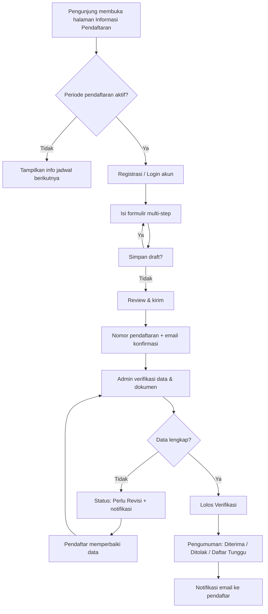
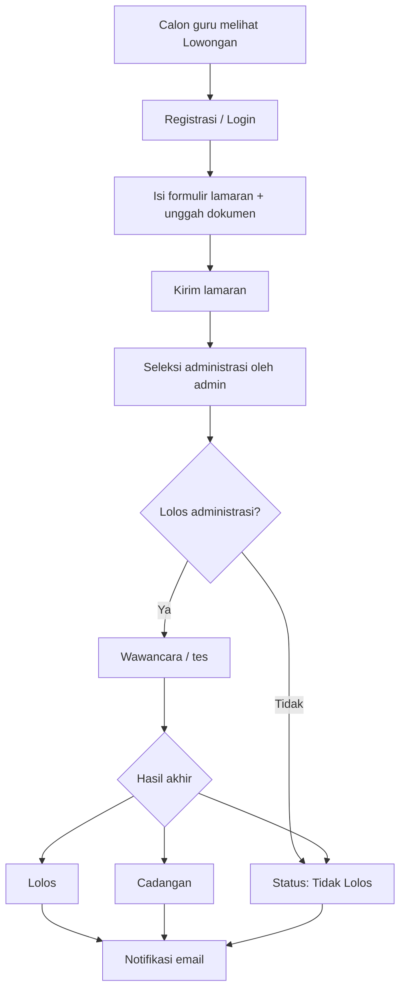
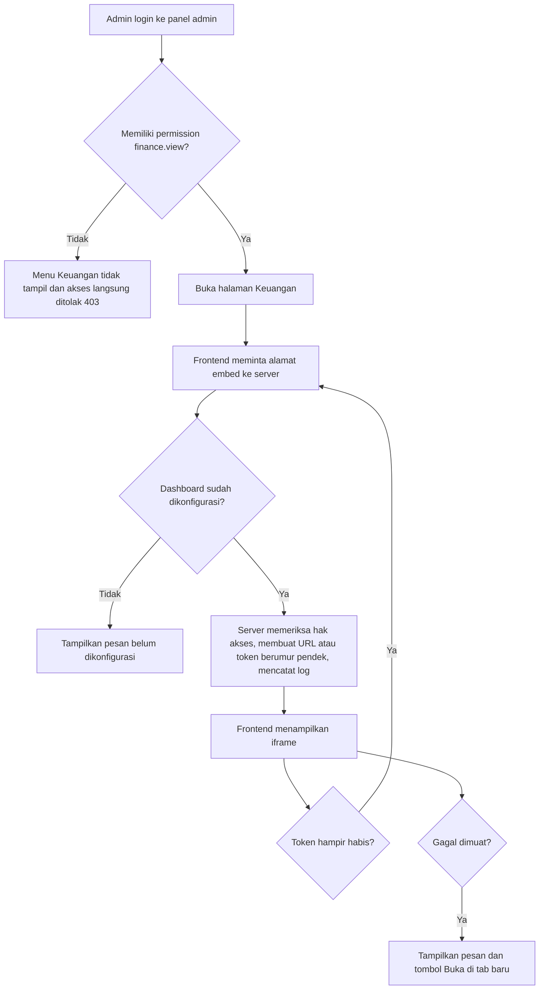
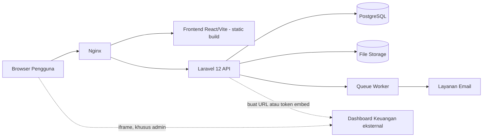
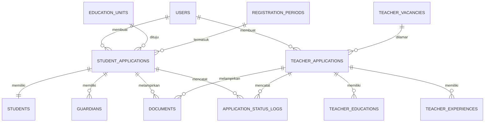

# PRD — Website Company Profile & Pendaftaran Yayasan Padindi

| | |
|---|---|
| **Nama Proyek** | Website Company Profile & Sistem Pendaftaran Siswa/Guru Yayasan Padindi |
| **Versi Dokumen** | 0.2 (Draft) |
| **Tanggal** | 28 Oktober 2026 |
| **Penulis** | [Nama penulis / tim pengembang] |
| **Mitra / Klien** | Yayasan Padindi (yayasan swasta bidang pendidikan) |
| **Status** | Draft — menunggu review dan persetujuan stakeholder |
| **Perubahan v0.2** | Penambahan fitur **Dashboard Keuangan** (tampilan iframe, khusus admin berwenang). Lihat Riwayat Revisi |

> Catatan: teks dalam tanda `[...]` adalah placeholder atau asumsi yang perlu dikonfirmasi bersama pihak yayasan sebelum dokumen disetujui.

---

## Daftar Isi

1. [Ringkasan Eksekutif](#1-ringkasan-eksekutif)
2. [Latar Belakang & Masalah](#2-latar-belakang--masalah)
3. [Tujuan & Metrik Keberhasilan](#3-tujuan--metrik-keberhasilan)
4. [Ruang Lingkup](#4-ruang-lingkup)
5. [Stakeholder & Pengguna](#5-stakeholder--pengguna)
6. [User Stories](#6-user-stories)
7. [Kebutuhan Fungsional](#7-kebutuhan-fungsional)
8. [Alur Pengguna](#8-alur-pengguna)
9. [Kebutuhan Non-Fungsional](#9-kebutuhan-non-fungsional)
10. [Arsitektur & Tech Stack](#10-arsitektur--tech-stack)
11. [Model Data](#11-model-data)
12. [Rancangan API](#12-rancangan-api)
13. [Desain & UX](#13-desain--ux)
14. [Keamanan & Privasi Data](#14-keamanan--privasi-data)
15. [Rencana Pengujian](#15-rencana-pengujian)
16. [Deployment & Operasional](#16-deployment--operasional)
17. [Timeline & Milestone](#17-timeline--milestone)
18. [Risiko & Mitigasi](#18-risiko--mitigasi)
19. [Asumsi & Ketergantungan](#19-asumsi--ketergantungan)
20. [Pertanyaan Terbuka](#20-pertanyaan-terbuka)
21. [Kriteria Penerimaan Proyek](#21-kriteria-penerimaan-proyek)
22. [Glosarium](#22-glosarium)
23. [Persetujuan](#23-persetujuan)

---

## 1. Ringkasan Eksekutif

Yayasan Padindi adalah yayasan swasta yang bergerak di bidang pendidikan. Proyek ini membangun sebuah website yang memiliki dua fungsi utama:

1. **Company profile** — menyajikan identitas, visi misi, unit pendidikan, kegiatan, dan informasi kontak yayasan kepada publik.
2. **Sistem pendaftaran online** — memungkinkan calon siswa (diwakili orang tua/wali) dan calon guru mendaftar secara daring, mengunggah dokumen, serta memantau status pendaftaran, sementara admin yayasan dapat memverifikasi dan mengelola data tersebut dari panel admin.

Mulai versi 0.2, panel admin juga dapat menampilkan **dashboard keuangan** yayasan. Fitur ini bersifat tampilan baca saja: dashboard disematkan lewat iframe dari sumber eksternal dan hanya dapat diakses admin dengan hak akses khusus.

Website dibangun dengan **Laravel 12** (backend/API), **React + Vite + TypeScript** (frontend), dan **PostgreSQL** (database).

## 2. Latar Belakang & Masalah

### 2.1 Latar Belakang
Yayasan membutuhkan kehadiran digital yang kredibel untuk memperkenalkan lembaga dan menjaring calon siswa serta tenaga pendidik.

### 2.2 Masalah yang Ingin Diselesaikan
| # | Masalah | Dampak |
|---|---|---|
| 1 | Informasi yayasan belum terpusat dan mudah diakses publik | Citra lembaga kurang terbangun, calon pendaftar kesulitan mencari informasi |
| 2 | Pendaftaran siswa dan guru dilakukan manual [konfirmasi: via formulir kertas / WhatsApp / datang langsung] | Proses lambat, data tersebar, rawan salah input dan berkas hilang |
| 3 | Tidak ada cara bagi pendaftar memantau status | Banyak pertanyaan berulang ke admin |
| 4 | Rekap data pendaftar dikerjakan manual | Memakan waktu panitia, sulit dianalisis |
| 5 | Informasi keuangan yayasan berada di luar sistem dan tidak terhubung dengan panel admin *[konfirmasi kebutuhan sebenarnya dengan yayasan]* | Pihak berwenang harus berpindah aplikasi, dan akses ke data keuangan sulit dikendalikan |

## 3. Tujuan & Metrik Keberhasilan

### 3.1 Tujuan
- **G1** — Menyediakan website company profile yang informatif, responsif, dan mudah dikelola pihak yayasan tanpa bantuan developer.
- **G2** — Mendigitalkan pendaftaran siswa baru secara end-to-end (isi formulir sampai pengumuman status).
- **G3** — Mendigitalkan pendaftaran guru/tenaga pendidik.
- **G4** — Mempermudah admin memverifikasi, memfilter, dan mengekspor data pendaftar.
- **G5** — Menyediakan akses dashboard keuangan yang terbatas dan terkontrol bagi admin berwenang langsung dari panel admin, tanpa menyimpan data keuangan di sistem ini.

### 3.2 Metrik Keberhasilan (KPI)
| Metrik | Target (contoh, perlu disepakati) |
|---|---|
| Persentase pendaftaran yang diterima via online | ≥ [90]% pada periode pendaftaran pertama setelah peluncuran |
| Tingkat penyelesaian formulir (mulai → kirim) | ≥ [70]% |
| Rata-rata waktu verifikasi oleh admin | ≤ [2] hari kerja |
| Waktu muat halaman publik (LCP) | ≤ 2,5 detik pada jaringan 4G |
| Waktu admin merekap data pendaftar | Berkurang signifikan dibanding proses manual (ekspor ≤ 1 menit) |
| Uptime | ≥ 99% per bulan |
| Akses dashboard keuangan oleh pengguna tanpa hak akses | 0 kejadian (diuji pada uji otorisasi dan UAT) |

## 4. Ruang Lingkup

### 4.1 Dalam Lingkup (In Scope)
- Halaman publik company profile (beranda, tentang, visi misi, unit pendidikan, berita, galeri, kontak).
- Pendaftaran online siswa baru, termasuk unggah dokumen dan pelacakan status.
- Pendaftaran online guru/tenaga pendidik, termasuk unggah dokumen dan pelacakan status.
- Panel admin: manajemen konten, manajemen pendaftar, manajemen periode pendaftaran, manajemen pengguna admin, dashboard ringkasan, ekspor data.
- Notifikasi email untuk peristiwa penting (konfirmasi pendaftaran, perubahan status).
- Pengelolaan role dan hak akses admin.
- **Dashboard Keuangan** pada panel admin: menampilkan dashboard dari sumber eksternal lewat iframe, tampilan baca saja, hanya untuk pengguna dengan hak akses `finance.view`.

### 4.2 Di Luar Lingkup (Out of Scope — Fase Ini)
- Sistem informasi akademik (nilai, absensi, jadwal, rapor).
- Pembayaran online (SPP, uang pendaftaran) dan integrasi payment gateway. *[konfirmasi bila uang pendaftaran perlu dibayar online]*
- Pencatatan transaksi, pembukuan, atau pembuatan laporan keuangan di dalam sistem ini. Fitur Dashboard Keuangan hanya **menampilkan** dashboard dari sumber eksternal; data keuangan tidak disimpan atau diolah oleh website.
- Aplikasi mobile native.
- Sistem tes seleksi online (CBT).
- Portal alumni, e-learning, dan forum.
- Multi-bahasa (default: Bahasa Indonesia). *[konfirmasi]*

### 4.3 Kandidat Fase Berikutnya
Notifikasi WhatsApp, pembayaran online, tes seleksi online, penjadwalan wawancara otomatis, portal wali murid.

## 5. Stakeholder & Pengguna

### 5.1 Stakeholder
| Peran | Keterlibatan |
|---|---|
| Pengurus/Pimpinan Yayasan Padindi | Pemilik produk, pemberi persetujuan akhir |
| Panitia/Admin pendaftaran yayasan | Pengguna utama panel admin |
| Tim pengembang | Perancangan dan implementasi |
| Kepala unit pendidikan [jika ada] | Penyedia konten dan kebutuhan per unit |

### 5.2 Persona Pengguna
| Persona | Deskripsi | Kebutuhan Utama |
|---|---|---|
| **Pengunjung Umum** | Masyarakat yang mencari informasi tentang yayasan | Informasi jelas, tampilan rapi, kontak mudah ditemukan |
| **Orang Tua/Wali Calon Siswa** | Mengakses terutama lewat ponsel, literasi digital beragam | Formulir sederhana, bisa disimpan sebagai draft, status pendaftaran transparan |
| **Calon Guru** | Pelamar tenaga pendidik | Formulir lamaran jelas, unggah CV/ijazah, tahu status seleksi |
| **Admin Yayasan** | Panitia yang mengelola konten dan pendaftar | Daftar pendaftar mudah difilter, verifikasi cepat, ekspor data |
| **Super Admin** | Penanggung jawab teknis/sistem | Kelola akun admin, role, dan pengaturan sistem, termasuk pengaturan dan hak akses dashboard keuangan |
| **Admin Berwenang Keuangan** | Pengguna admin yang memiliki permission `finance.view` (default: Super Admin; dapat diberikan ke role lain) | Membuka dashboard keuangan dengan cepat dan aman dari panel admin |

## 6. User Stories

### Pengunjung
- US-01: Sebagai pengunjung, saya ingin melihat profil dan visi misi yayasan agar saya mengenal lembaga ini.
- US-02: Sebagai pengunjung, saya ingin melihat daftar unit pendidikan beserta informasinya agar saya bisa memilih yang sesuai.
- US-03: Sebagai pengunjung, saya ingin membaca berita dan melihat galeri kegiatan agar saya tahu aktivitas yayasan.
- US-04: Sebagai pengunjung, saya ingin menemukan kontak dan lokasi yayasan agar saya dapat menghubungi atau datang langsung.

### Orang Tua / Calon Siswa
- US-05: Sebagai orang tua, saya ingin membuat akun agar saya dapat mendaftarkan anak saya dan memantau prosesnya.
- US-06: Sebagai orang tua, saya ingin mengisi formulir secara bertahap dan menyimpannya sebagai draft agar saya tidak kehilangan data bila belum selesai.
- US-07: Sebagai orang tua, saya ingin mengunggah dokumen dari ponsel agar saya tidak perlu datang membawa berkas fisik.
- US-08: Sebagai orang tua, saya ingin menerima nomor pendaftaran dan notifikasi saat status berubah agar saya selalu tahu perkembangannya.
- US-09: Sebagai orang tua, saya ingin memperbaiki data/dokumen jika admin meminta revisi agar pendaftaran anak saya tetap bisa diproses.

### Calon Guru
- US-10: Sebagai calon guru, saya ingin melihat lowongan yang tersedia agar saya bisa melamar posisi yang sesuai.
- US-11: Sebagai calon guru, saya ingin mengisi data diri, pendidikan, dan pengalaman serta mengunggah CV/ijazah agar lamaran saya lengkap.
- US-12: Sebagai calon guru, saya ingin memantau status lamaran saya agar saya tahu hasilnya.

### Admin
- US-13: Sebagai admin, saya ingin mengubah konten halaman, berita, dan galeri tanpa bantuan developer agar informasi selalu terbaru.
- US-14: Sebagai admin, saya ingin melihat, mencari, dan memfilter pendaftar agar saya dapat bekerja efisien.
- US-15: Sebagai admin, saya ingin memverifikasi dokumen dan mengubah status pendaftar (termasuk meminta revisi) agar proses seleksi terdokumentasi.
- US-16: Sebagai admin, saya ingin mengatur periode/gelombang dan kuota pendaftaran agar pendaftaran terbuka dan tertutup otomatis.
- US-17: Sebagai admin, saya ingin mengekspor data pendaftar ke Excel/PDF agar mudah dilaporkan dan diarsipkan.
- US-18: Sebagai admin, saya ingin melihat dashboard ringkasan agar saya memahami kondisi pendaftaran secara cepat.

### Super Admin
- US-19: Sebagai super admin, saya ingin mengelola akun admin dan hak aksesnya agar keamanan sistem terjaga.

### Admin Berwenang Keuangan
- US-20: Sebagai admin yang berwenang, saya ingin melihat dashboard keuangan yayasan di dalam panel admin agar saya tidak perlu berpindah aplikasi untuk memantau kondisi keuangan.
- US-21: Sebagai super admin, saya ingin mengatur sumber dashboard keuangan dan menentukan role mana yang boleh melihatnya agar data keuangan hanya diakses pihak yang tepat.
- US-22: Sebagai pengurus yayasan, saya ingin setiap akses ke dashboard keuangan tercatat agar penggunaannya dapat ditelusuri.

## 7. Kebutuhan Fungsional

Prioritas menggunakan skema **MoSCoW**: **M** (Must), **S** (Should), **C** (Could), **W** (Won't — fase ini).

### 7.1 Modul Company Profile (Publik)

| ID | Kebutuhan | Prioritas |
|---|---|---|
| FR-001 | Halaman **Beranda** berisi hero/banner, ringkasan yayasan, unit pendidikan, berita terbaru, dan tombol ajakan (CTA) ke pendaftaran | M |
| FR-002 | Halaman **Tentang Yayasan**: sejarah, profil, struktur organisasi | M |
| FR-003 | Halaman **Visi & Misi** | M |
| FR-004 | Halaman **Unit Pendidikan** (daftar) dan halaman detail per unit (profil, fasilitas, program, kontak) | M |
| FR-005 | Halaman **Berita/Kegiatan**: daftar dengan pagination, detail artikel, kategori | M |
| FR-006 | Halaman **Galeri** foto kegiatan (album) | S |
| FR-007 | Halaman **Kontak**: alamat, telepon, email, peta lokasi, dan formulir pesan | M |
| FR-008 | Halaman **Informasi Pendaftaran**: syarat, alur, jadwal, dan biaya (jika ada) | M |
| FR-009 | Halaman **Lowongan Guru**: daftar posisi terbuka dan syaratnya | S |
| FR-010 | Pengaturan SEO per halaman (title, meta description, Open Graph) dan sitemap | S |
| FR-011 | Footer dengan tautan cepat dan media sosial | M |
| FR-012 | Halaman statis kebijakan privasi dan syarat penggunaan | M |

### 7.2 Modul Autentikasi Pengguna (Pendaftar)

| ID | Kebutuhan | Prioritas |
|---|---|---|
| FR-020 | Registrasi akun pendaftar (nama, email, nomor telepon, kata sandi) | M |
| FR-021 | Verifikasi email setelah registrasi | S |
| FR-022 | Login dan logout | M |
| FR-023 | Lupa dan reset kata sandi lewat email | M |
| FR-024 | Pembatasan percobaan login (rate limiting) | M |
| FR-025 | Ubah profil dan kata sandi | S |

### 7.3 Modul Pendaftaran Siswa

| ID | Kebutuhan | Prioritas |
|---|---|---|
| FR-030 | Formulir pendaftaran bertahap (multi-step) dengan indikator progres | M |
| FR-031 | **Langkah 1 — Pilihan Unit**: jenjang/unit dan (jika ada) jalur/gelombang pendaftaran | M |
| FR-032 | **Langkah 2 — Data Calon Siswa**: nama lengkap, jenis kelamin, tempat/tanggal lahir, NIK, NISN (opsional), agama, alamat, asal sekolah, [data lain sesuai kebutuhan yayasan] | M |
| FR-033 | **Langkah 3 — Data Orang Tua/Wali**: data ayah, ibu, dan wali (nama, pekerjaan, kontak, penghasilan *[opsional/konfirmasi]*) | M |
| FR-034 | **Langkah 4 — Unggah Dokumen**: akta kelahiran, kartu keluarga, pas foto, rapor/ijazah terakhir, dokumen lain sesuai ketentuan unit | M |
| FR-035 | **Langkah 5 — Review & Kirim**: ringkasan data, pernyataan kebenaran data, persetujuan penggunaan data pribadi | M |
| FR-036 | Simpan sebagai **draft** otomatis/manual dan lanjutkan di kemudian hari | M |
| FR-037 | Validasi sisi klien dan server (format NIK, tanggal, ukuran/tipe berkas) | M |
| FR-038 | Pembuatan **nomor pendaftaran** unik setelah formulir dikirim | M |
| FR-039 | Halaman **status pendaftaran** dengan riwayat perubahan status | M |
| FR-040 | Pendaftar dapat **merevisi** data/dokumen saat status "Perlu Revisi" | M |
| FR-041 | Cetak/unduh **bukti pendaftaran** (PDF) | S |
| FR-042 | Notifikasi email: konfirmasi pengiriman, perubahan status, permintaan revisi | M |
| FR-043 | Satu akun dapat mendaftarkan lebih dari satu anak | S |
| FR-044 | Pendaftaran otomatis ditutup bila di luar periode atau kuota penuh | M |

**Alur status siswa:** `Draft → Terkirim → Dalam Verifikasi → (Perlu Revisi ↔ Dalam Verifikasi) → Lolos Verifikasi → Diterima / Ditolak / Daftar Tunggu`

### 7.4 Modul Pendaftaran Guru

| ID | Kebutuhan | Prioritas |
|---|---|---|
| FR-050 | Formulir lamaran multi-step | M |
| FR-051 | **Data Diri**: nama, kontak, alamat, tempat/tanggal lahir, NIK | M |
| FR-052 | **Pendidikan & Kualifikasi**: jenjang, institusi, jurusan, tahun lulus, sertifikasi (mis. sertifikat pendidik) | M |
| FR-053 | **Pengalaman Mengajar/Kerja**: instansi, jabatan, periode (dapat ditambah lebih dari satu) | M |
| FR-054 | **Posisi yang Dilamar**: unit, mata pelajaran/bidang | M |
| FR-055 | **Unggah Dokumen**: CV, ijazah, transkrip, sertifikat, KTP, pas foto, surat lamaran | M |
| FR-056 | Simpan draft dan lanjutkan nanti | S |
| FR-057 | Nomor lamaran unik dan halaman status lamaran | M |
| FR-058 | Notifikasi email perubahan status | M |

**Alur status guru:** `Draft → Terkirim → Seleksi Administrasi → Wawancara/Tes → Lolos / Tidak Lolos / Cadangan`

### 7.5 Modul Panel Admin

| ID | Kebutuhan | Prioritas |
|---|---|---|
| FR-060 | Login admin terpisah dari pendaftar | M |
| FR-061 | **Dashboard**: jumlah pendaftar per periode, unit, dan status; grafik ringkas | S |
| FR-062 | **Manajemen Pendaftar Siswa**: tabel dengan pencarian, filter (unit, status, periode), sortir, pagination | M |
| FR-063 | Detail pendaftar: lihat seluruh data dan pratinjau/unduh dokumen | M |
| FR-064 | Verifikasi per dokumen (sesuai/tidak sesuai + catatan) dan ubah status pendaftaran dengan catatan | M |
| FR-065 | Aksi massal (mis. ubah status beberapa pendaftar sekaligus) | C |
| FR-066 | **Manajemen Pendaftar Guru** dengan fitur setara FR-062–FR-064 | M |
| FR-067 | **Manajemen Periode/Gelombang**: tanggal buka/tutup, kuota per unit, status aktif | M |
| FR-068 | **Manajemen Lowongan Guru** (tambah, ubah, tutup lowongan) | S |
| FR-069 | **Manajemen Unit Pendidikan** (CRUD) | M |
| FR-070 | **CMS**: kelola halaman statis, berita, kategori, galeri, banner, kontak, dan media sosial | M |
| FR-071 | Editor teks kaya (rich text) dan unggah gambar pada berita/halaman | M |
| FR-072 | **Ekspor** data pendaftar ke Excel (XLSX/CSV) dan PDF dengan filter | M |
| FR-073 | **Pengumuman hasil**: publikasi status massal dan pengiriman notifikasi | S |
| FR-074 | Kelola pesan masuk dari formulir kontak | S |
| FR-075 | **Manajemen pengguna admin & role** (Super Admin, Admin Pendaftaran, Admin Konten) | M |
| FR-076 | **Log aktivitas** (audit trail) untuk aksi penting admin | S |
| FR-077 | Pengaturan situs (nama, logo, kontak, template email) | S |

### 7.6 Matriks Hak Akses (Usulan)

| Fitur | Super Admin | Admin Pendaftaran | Admin Konten |
|---|:---:|:---:|:---:|
| Kelola akun admin & role | ✅ | ❌ | ❌ |
| Pengaturan situs | ✅ | ❌ | ❌ |
| Kelola periode & kuota | ✅ | ✅ | ❌ |
| Kelola pendaftar siswa/guru | ✅ | ✅ | ❌ |
| Ekspor data pendaftar | ✅ | ✅ | ❌ |
| Kelola konten (CMS) | ✅ | ❌ | ✅ |
| Lihat dashboard | ✅ | ✅ | ✅ |
| Lihat dashboard keuangan (`finance.view`) | ✅ | ❌ | ❌ |
| Lihat log aktivitas | ✅ | ❌ | ❌ |

> Dashboard keuangan memakai permission terpisah `finance.view`. Secara default hanya **Super Admin** yang memilikinya; Super Admin dapat memberikannya ke role lain lewat manajemen role. Hak ini tidak ikut otomatis pada Admin Pendaftaran maupun Admin Konten.

### 7.7 Modul Dashboard Keuangan (Admin)

Modul ini **menampilkan** dashboard keuangan dari sumber eksternal di dalam panel admin. Website tidak menyimpan, menyalin, atau mengolah data keuangan.

Prioritas modul: **Should**. Namun bila modul dibangun, kebutuhan keamanan di dalamnya (FR-081, FR-082 bila didukung penyedia, FR-084, FR-086) **wajib dipenuhi dan tidak boleh ditunda**.

| ID | Kebutuhan | Prioritas |
|---|---|---|
| FR-080 | Halaman **Keuangan** pada panel admin yang menampilkan dashboard eksternal di dalam iframe, mengisi area kerja | S |
| FR-081 | Akses **hanya untuk pengguna dengan permission `finance.view`**. Pengguna tanpa hak tidak melihat menu, dan permintaan ke server ditolak (403) | S |
| FR-082 | Alamat atau token dashboard diberikan oleh **server saat halaman dibuka** (bukan ditanam di kode frontend), berumur pendek bila penyedia mendukung penandatanganan token, dan diperbarui otomatis sebelum kedaluwarsa | S |
| FR-083 | Super Admin dapat mengatur **penyedia dan alamat dashboard** pada pengaturan situs; rahasia penandatangan token disimpan di konfigurasi server, bukan di database | S |
| FR-084 | Setiap pembukaan dashboard **dicatat** di log aktivitas (siapa dan kapan) | S |
| FR-085 | **Keadaan khusus**: belum dikonfigurasi, gagal dimuat, atau token habis menampilkan pesan jelas dalam Bahasa Indonesia, disertai tombol "Buka di tab baru" sebagai cadangan | S |
| FR-086 | **Kontrol keamanan iframe**: hanya host dashboard yang diizinkan pada kebijakan CSP (`frame-src`), atribut `sandbox` dan `referrerpolicy="no-referrer"`, serta `title` deskriptif untuk aksesibilitas | S |
| FR-087 | Tampilan dioptimalkan untuk desktop; dapat dibuka di ponsel atau tablet tanpa jaminan kenyamanan penuh (bergantung pada penyedia dashboard) | C |

**Ketentuan dan batasan:**

- Dashboard sumber harus mengizinkan di-embed oleh domain website dan sebaiknya memiliki pembatasan akses sendiri (token atau akun), **bukan tautan publik terbuka**. Perlindungan di website saja tidak cukup karena alamat iframe dapat dilihat di browser.
- Penyedia dashboard belum ditentukan *[Looker Studio / Metabase / Power BI / lainnya, menunggu Q14]*. Cara pembuatan alamat atau token embed bergantung pada penyedia yang dipilih.
- Kelayakan embed (apakah penyedia mengizinkan iframe dan pembatasan akses) **diuji lebih dahulu** sebelum modul dibangun.

## 8. Alur Pengguna

### 8.1 Alur Pendaftaran Siswa



### 8.2 Alur Pendaftaran Guru



### 8.3 Alur Akses Dashboard Keuangan



## 9. Kebutuhan Non-Fungsional

| ID | Kategori | Kebutuhan |
|---|---|---|
| NFR-01 | **Performa** | LCP halaman publik ≤ 2,5 detik (4G); respons API umum ≤ 500 ms (p95) pada beban normal; gambar dioptimasi (kompresi, lazy loading, format modern) |
| NFR-02 | **Skalabilitas** | Mampu menangani lonjakan pengguna saat periode pendaftaran [estimasi: ... pengguna bersamaan — konfirmasi] |
| NFR-03 | **Ketersediaan** | Uptime ≥ 99%; backup database harian dan retensi minimal [30] hari |
| NFR-04 | **Keamanan** | Lihat bagian 14 |
| NFR-05 | **Responsif** | Tampilan optimal di ponsel, tablet, dan desktop (pendekatan mobile-first) |
| NFR-06 | **Kompatibilitas** | Dua versi mayor terbaru Chrome, Firefox, Safari, Edge; Android & iOS browser |
| NFR-07 | **Aksesibilitas** | Mengacu WCAG 2.1 level AA untuk halaman publik (kontras, label form, navigasi keyboard, alt text) |
| NFR-08 | **SEO** | Halaman publik dapat diindeks mesin pencari (SSR/pre-render atau solusi setara), meta tag, sitemap.xml, robots.txt |
| NFR-09 | **Usability** | Formulir pendaftaran dapat diselesaikan tanpa panduan; pesan error jelas dalam Bahasa Indonesia |
| NFR-10 | **Maintainability** | Kode mengikuti standar (PSR-12 untuk PHP, ESLint + Prettier untuk TS), terdokumentasi, memiliki pengujian otomatis dasar |
| NFR-11 | **Lokalisasi** | Bahasa Indonesia; zona waktu WIB (Asia/Jakarta) [konfirmasi] |
| NFR-12 | **Observabilitas** | Pencatatan log aplikasi dan error; pemantauan uptime |
| NFR-13 | **Keamanan integrasi** | Dashboard keuangan hanya dapat dimuat dari satu host yang diizinkan (CSP `frame-src`); alamat atau token embed dibuat server dan berumur pendek; tidak ada data keuangan yang disimpan di sistem ini |

## 10. Arsitektur & Tech Stack

### 10.1 Tech Stack

| Lapisan | Teknologi |
|---|---|
| Backend | **Laravel 12** (PHP 8.2+) — REST API |
| Frontend | **React + Vite + TypeScript** |
| Database | **PostgreSQL** |
| Autentikasi | Laravel Sanctum (token/SPA cookie) |
| Otorisasi | Role & permission (mis. `spatie/laravel-permission`) |
| Antrean (queue) | Laravel Queue (driver database/Redis) untuk email dan ekspor |
| Penyimpanan file | Laravel Filesystem (lokal/S3-compatible) dengan akses terbatas |
| Email | SMTP / layanan email transaksional [pilih penyedia] |
| Web server | Nginx + PHP-FPM |
| Integrasi dashboard keuangan | iframe tersemat dari penyedia eksternal *[Looker Studio / Metabase / Power BI, ditentukan kemudian]* |

### 10.2 Pustaka Frontend yang Disarankan *(opsional, dapat disesuaikan)*
React Router, TanStack Query, React Hook Form + Zod (validasi), Tailwind CSS, komponen UI (mis. shadcn/ui), Axios/Fetch.

### 10.3 Diagram Arsitektur



### 10.4 Keputusan Arsitektur yang Perlu Dicatat

| Topik | Opsi | Rekomendasi Awal |
|---|---|---|
| Pola aplikasi | Monorepo vs dua repositori terpisah | Dua direktori (`/backend`, `/frontend`) dalam satu repo agar mudah dikelola |
| SEO halaman publik | SPA murni vs pre-render/SSR | Pre-render/SSR untuk halaman publik atau gunakan solusi prerendering; panel admin & area pendaftar tetap SPA |
| Penyimpanan dokumen | Disk lokal vs object storage | Disk privat (tidak publik) pada tahap awal; migrasi ke object storage jika volume besar |
| Autentikasi SPA | Sanctum cookie vs token | Sanctum (cookie-based) bila frontend dan API satu domain induk |
| Dashboard keuangan | Tautan buka di tab baru vs iframe tersemat; URL statis vs token bertanda tangan | Iframe tersemat; URL atau token dibuat server dan berumur pendek bila penyedia mendukung; hanya satu host diizinkan lewat CSP |

## 11. Model Data

### 11.1 Daftar Entitas Utama

| Tabel | Deskripsi |
|---|---|
| `users` | Akun semua pengguna (pendaftar dan admin) |
| `roles`, `permissions`, pivot | Role dan hak akses admin |
| `education_units` | Unit pendidikan (TK/SD/SMP/SMA/SMK, dst.) |
| `registration_periods` | Periode/gelombang pendaftaran dan kuota |
| `student_applications` | Pendaftaran siswa (nomor, status, periode, unit) |
| `students` | Data calon siswa |
| `guardians` | Data ayah/ibu/wali |
| `teacher_vacancies` | Lowongan guru |
| `teacher_applications` | Lamaran guru |
| `teacher_educations` | Riwayat pendidikan pelamar |
| `teacher_experiences` | Riwayat pengalaman pelamar |
| `documents` | Berkas unggahan (polimorfik ke aplikasi siswa/guru) |
| `application_status_logs` | Riwayat perubahan status |
| `posts`, `post_categories` | Berita/artikel |
| `pages` | Halaman statis |
| `galleries`, `gallery_items` | Album dan foto |
| `banners` | Banner beranda |
| `contact_messages` | Pesan dari formulir kontak |
| `settings` | Pengaturan situs |
| `activity_logs` | Audit trail |

> **Dashboard Keuangan tidak menambah tabel.** Penyedia dan alamat dashboard disimpan sebagai kunci pada `settings` (mis. `finance_dashboard_provider`, `finance_dashboard_url`); rahasia penandatangan token disimpan di `.env`. Permission baru `finance.view` ditambahkan ke tabel `permissions`.

### 11.2 Diagram Relasi (Ringkas)



### 11.3 Contoh Struktur Tabel Kunci

**`student_applications`**
| Kolom | Tipe | Keterangan |
|---|---|---|
| id | bigint (PK) | |
| user_id | bigint (FK) | Pemilik akun pendaftar |
| registration_period_id | bigint (FK) | |
| education_unit_id | bigint (FK) | |
| registration_number | varchar, unique | Dibuat saat dikirim |
| status | varchar | draft, submitted, in_review, revision_required, verified, accepted, rejected, waitlisted |
| submitted_at | timestamp, null | |
| admin_note | text, null | |
| created_at, updated_at | timestamp | |

**`students`**
| Kolom | Tipe | Keterangan |
|---|---|---|
| id | bigint (PK) | |
| student_application_id | bigint (FK, unique) | |
| full_name | varchar | |
| gender | varchar | |
| birth_place, birth_date | varchar, date | |
| nik | varchar(16) | Data sensitif — dibatasi aksesnya |
| nisn | varchar, null | |
| religion | varchar | |
| address | text | |
| previous_school | varchar | |

**`documents`**
| Kolom | Tipe | Keterangan |
|---|---|---|
| id | bigint (PK) | |
| documentable_type, documentable_id | morph | Relasi ke aplikasi siswa/guru |
| type | varchar | birth_certificate, family_card, photo, report_card, cv, diploma, dll. |
| path | varchar | Lokasi file di storage privat |
| original_name, mime_type, size | varchar, varchar, int | |
| verification_status | varchar | pending, valid, invalid |
| verification_note | text, null | |

> Skema lengkap (tipe data, indeks, constraint) disusun pada fase desain teknis. Gunakan **soft delete** untuk data pendaftaran dan kunci indeks pada kolom pencarian utama (`registration_number`, `status`, `education_unit_id`, `registration_period_id`).

## 12. Rancangan API

Prefiks: `/api/v1`. Format: JSON. Autentikasi: Sanctum. Format error konsisten (`message`, `errors`).

### 12.1 Publik

| Method | Endpoint | Deskripsi |
|---|---|---|
| GET | `/public/settings` | Pengaturan situs (nama, logo, kontak) |
| GET | `/public/units` · `/public/units/{slug}` | Daftar dan detail unit pendidikan |
| GET | `/public/posts` · `/public/posts/{slug}` | Berita |
| GET | `/public/galleries` | Galeri |
| GET | `/public/pages/{slug}` | Halaman statis |
| GET | `/public/vacancies` | Lowongan guru |
| GET | `/public/registration-info` | Periode aktif, kuota, persyaratan |
| POST | `/public/contact` | Kirim pesan kontak |

### 12.2 Autentikasi

| Method | Endpoint | Deskripsi |
|---|---|---|
| POST | `/auth/register` | Registrasi pendaftar |
| POST | `/auth/login` | Login |
| POST | `/auth/logout` | Logout |
| POST | `/auth/forgot-password` · `/auth/reset-password` | Reset kata sandi |
| GET | `/auth/me` | Profil pengguna saat ini |

### 12.3 Area Pendaftar

| Method | Endpoint | Deskripsi |
|---|---|---|
| GET/POST | `/student-applications` | Daftar & buat pendaftaran siswa |
| GET/PUT | `/student-applications/{id}` | Detail & ubah (saat draft/revisi) |
| POST | `/student-applications/{id}/documents` | Unggah dokumen |
| POST | `/student-applications/{id}/submit` | Kirim pendaftaran |
| GET | `/student-applications/{id}/receipt` | Unduh bukti pendaftaran (PDF) |
| GET/POST | `/teacher-applications` | Daftar & buat lamaran guru |
| GET/PUT | `/teacher-applications/{id}` | Detail & ubah |
| POST | `/teacher-applications/{id}/documents` | Unggah dokumen |
| POST | `/teacher-applications/{id}/submit` | Kirim lamaran |

### 12.4 Admin

| Method | Endpoint | Deskripsi |
|---|---|---|
| GET | `/admin/dashboard` | Statistik ringkas |
| GET | `/admin/finance-dashboard` | Alamat atau token embed dashboard keuangan (butuh permission `finance.view`) |
| GET | `/admin/student-applications` | Daftar dengan filter & pencarian |
| GET | `/admin/student-applications/{id}` | Detail |
| PATCH | `/admin/student-applications/{id}/status` | Ubah status + catatan |
| PATCH | `/admin/documents/{id}/verification` | Verifikasi dokumen |
| GET | `/admin/student-applications/export` | Ekspor XLSX/CSV/PDF |
| GET/PATCH | `/admin/teacher-applications...` | Setara dengan pendaftar siswa |
| CRUD | `/admin/periods`, `/admin/units`, `/admin/vacancies` | Master data |
| CRUD | `/admin/posts`, `/admin/pages`, `/admin/galleries`, `/admin/banners` | CMS |
| GET/PATCH | `/admin/contact-messages` | Pesan masuk |
| CRUD | `/admin/users`, `/admin/roles` | Pengguna admin & role |
| GET | `/admin/activity-logs` | Audit trail |
| GET/PUT | `/admin/settings` | Pengaturan situs |

## 13. Desain & UX

### 13.1 Peta Situs (Sitemap)

```
Beranda
├── Tentang Yayasan
│   ├── Profil & Sejarah
│   ├── Visi & Misi
│   └── Struktur Organisasi
├── Unit Pendidikan
│   └── [Detail Unit]
├── Berita & Kegiatan
│   └── [Detail Berita]
├── Galeri
├── Pendaftaran
│   ├── Informasi & Alur
│   ├── Pendaftaran Siswa Baru
│   └── Pendaftaran Guru / Lowongan
├── Kontak
├── Masuk / Daftar Akun
│   └── Dashboard Pendaftar (status, dokumen, bukti)
└── Kebijakan Privasi

Panel Admin (/admin)
├── Dashboard
├── Keuangan (khusus admin berwenang)
├── Pendaftar Siswa
├── Pendaftar Guru
├── Periode & Kuota
├── Unit Pendidikan
├── Lowongan
├── Konten (Halaman, Berita, Galeri, Banner)
├── Pesan Masuk
├── Pengguna & Role
├── Log Aktivitas
└── Pengaturan
```

### 13.2 Prinsip Desain
- **Mobile-first** dan ringan; mayoritas orang tua mengakses via ponsel.
- Identitas visual mengikuti logo dan warna Yayasan Padindi [palet warna & font: akan ditentukan].
- Formulir pendaftaran dipecah per langkah, dengan label jelas, contoh pengisian, dan pesan error yang membantu.
- Panel admin mengutamakan efisiensi: tabel dengan filter, aksi cepat, dan pratinjau dokumen.
- Wireframe dan mockup: [tautan Figma — menyusul].

### 13.3 Aturan Unggah Dokumen (Usulan)
- Format: PDF, JPG, PNG.
- Ukuran maksimum: [2–5] MB per berkas.
- Pas foto: rasio dan ukuran minimum [ditentukan].
- Pemindaian virus/validasi tipe MIME pada sisi server.

### 13.4 Halaman Keuangan (Admin)
- Iframe mengisi sisa area kerja di bawah judul halaman; judul halaman dilengkapi tombol "Buka di tab baru".
- Menu **Keuangan** hanya tampil bagi pengguna dengan `finance.view`; penegakan sebenarnya tetap di server.
- Keadaan yang harus dirancang: memuat, belum dikonfigurasi, gagal dimuat, dan sesi atau token habis (dengan perbaruan otomatis).
- Dioptimalkan untuk desktop; di ponsel tampil dengan gulir internal dan tanpa jaminan kenyamanan penuh.

## 14. Keamanan & Privasi Data

Website memproses **data pribadi anak dan keluarga** (NIK, alamat, dokumen identitas), sehingga keamanan dan privasi menjadi prioritas.

| Area | Kebutuhan |
|---|---|
| Transport | HTTPS wajib (TLS), HSTS |
| Autentikasi | Hash kata sandi (bcrypt/argon2), kebijakan kata sandi minimum, rate limiting login, opsi 2FA untuk akun admin *(S)* |
| Otorisasi | Role-based access; pendaftar hanya dapat mengakses data miliknya (policy Laravel); pemeriksaan di sisi server untuk setiap endpoint |
| Validasi input | Validasi server-side (Form Request), sanitasi keluaran untuk mencegah XSS, query terparameter (Eloquent) untuk mencegah SQL injection, proteksi CSRF |
| Berkas | Disimpan di storage privat; diakses lewat URL bertanda tangan/terotorisasi; validasi MIME dan ukuran; nama berkas diacak |
| Data sensitif | Pembatasan akses pada NIK/dokumen identitas; pertimbangkan enkripsi kolom untuk NIK |
| Audit | Log aktivitas admin pada aksi penting (ubah status, ekspor, hapus) |
| Backup | Backup terenkripsi, uji pemulihan berkala |
| Kepatuhan | Mengacu pada **UU No. 27 Tahun 2022 tentang Pelindungan Data Pribadi (UU PDP)**: persetujuan eksplisit, tujuan penggunaan jelas, persetujuan orang tua/wali untuk data anak, kebijakan privasi, dan prosedur penghapusan/retensi data *[review oleh pihak yayasan/konsultan hukum]* |
| Retensi | Kebijakan penyimpanan dan penghapusan data pendaftar yang tidak diterima: [ditentukan bersama yayasan] |
| Konfigurasi | Secret di variabel lingkungan; `APP_DEBUG=false` di produksi; dependensi diperbarui berkala |
| Anti-spam | CAPTCHA (mis. Turnstile/reCAPTCHA) pada registrasi dan formulir kontak |
| Dashboard keuangan (iframe) | Akses dikendalikan permission `finance.view` di server; URL atau token embed dibuat server, berumur pendek, dengan respons `no-store`; CSP `frame-src` hanya untuk satu host dashboard; iframe memakai `sandbox` dan `referrerpolicy="no-referrer"`; pembukaan dicatat di log aktivitas; dashboard sumber dibatasi aksesnya sendiri (bukan tautan publik terbuka) karena alamat iframe terlihat di browser |

## 15. Rencana Pengujian

| Jenis | Cakupan | Alat (usulan) |
|---|---|---|
| Unit & Feature Test (backend) | Validasi, kebijakan akses, alur status, API | Pest/PHPUnit |
| Unit/Component Test (frontend) | Komponen formulir, validasi | Vitest + Testing Library |
| End-to-End | Alur registrasi → pendaftaran → verifikasi admin | Playwright/Cypress |
| Uji beban | Simulasi lonjakan pendaftar | k6/JMeter |
| Uji keamanan | OWASP Top 10 dasar, uji otorisasi antar-pengguna | Checklist manual + alat pemindai |
| Uji otorisasi dashboard keuangan | Pendaftar, Admin Konten, dan Admin Pendaftaran tanpa `finance.view` ditolak; token embed kedaluwarsa; header CSP hanya mengizinkan host yang ditentukan | Pest (feature test) + pemeriksaan header manual |
| Uji kompatibilitas | Browser dan perangkat utama | Manual/BrowserStack |
| **UAT** | Pengujian oleh perwakilan yayasan dengan skenario nyata | Skenario UAT tertulis |

## 16. Deployment & Operasional

- **Lingkungan:** Local → Staging → Production.
- **Hosting:** [VPS/Cloud — ditentukan]. Kebutuhan minimum: PHP 8.2+, PostgreSQL, Nginx, Node (untuk build), worker queue (Supervisor), cron scheduler.
- **CI/CD:** pipeline otomatis (lint, test, build, deploy) *[mis. GitHub Actions]*.
- **Domain & SSL:** [domain milik yayasan — konfirmasi ketersediaan].
- **Backup:** harian untuk database dan berkas unggahan.
- **Monitoring:** pemantauan uptime dan error (mis. Sentry, UptimeRobot).
- **Serah terima:** dokumentasi teknis, panduan admin (manual/video singkat), dan pelatihan untuk admin yayasan.
- **Pemeliharaan pasca-peluncuran:** [masa garansi bug-fix dan opsi kontrak pemeliharaan — disepakati terpisah].

## 17. Timeline & Milestone

Estimasi awal (dapat disesuaikan dengan sumber daya dan tenggat yayasan, mis. sebelum periode PPDB):

| Fase | Aktivitas | Estimasi |
|---|---|---|
| 1. Discovery & Desain | Wawancara kebutuhan, finalisasi PRD, wireframe, desain UI, skema database | Minggu 1–3 |
| 2. Fondasi Teknis | Setup repo, CI, autentikasi, role, layout dasar, panel admin dasar | Minggu 3–4 |
| 3. Company Profile & CMS | Halaman publik, CMS (halaman, berita, galeri, unit, kontak) | Minggu 5–6 |
| 4. Modul Pendaftaran Siswa | Formulir, unggah dokumen, status, notifikasi, verifikasi admin, periode/kuota | Minggu 7–10 |
| 5. Modul Pendaftaran Guru | Lowongan, formulir lamaran, seleksi admin | Minggu 11–12 |
| 6. Ekspor, Dashboard, Log | Ekspor data, statistik, audit trail | Minggu 12–13 |
| 6b. Dashboard Keuangan | Endpoint embed, halaman admin, permission, CSP, pengujian otorisasi (bergantung pada Q14 dan kesiapan dashboard sumber) | Minggu 13 *[estimasi tambahan sekitar 1 minggu; konfirmasi]* |
| 7. Pengujian & UAT | QA, perbaikan, UAT bersama yayasan, uji beban & keamanan | Minggu 13–15 |
| 8. Peluncuran & Serah Terima | Deployment produksi, migrasi konten, pelatihan admin | Minggu 16 |

**Milestone utama:** M1 — PRD & desain disetujui · M2 — Company profile live di staging · M3 — Pendaftaran siswa selesai · M4 — UAT lulus · M5 — Go-live.

## 18. Risiko & Mitigasi

| # | Risiko | Dampak | Mitigasi |
|---|---|---|---|
| R1 | Konten (teks, foto, logo) dari yayasan terlambat | Jadwal mundur | Tetapkan tenggat konten di awal; gunakan placeholder; tunjuk PIC konten |
| R2 | Perubahan kebutuhan di tengah pengembangan (*scope creep*) | Biaya & jadwal membengkak | Kunci ruang lingkup via PRD; kelola perubahan lewat *change request* |
| R3 | Lonjakan akses saat pendaftaran dibuka | Situs lambat/gagal | Uji beban, caching, antrean untuk proses berat, sizing server memadai |
| R4 | Kebocoran data pribadi | Risiko hukum & reputasi | Terapkan kontrol keamanan bagian 14, akses minimum, audit |
| R5 | Orang tua kesulitan mengisi formulir/unggah berkas | Pendaftaran tidak tuntas | UX sederhana, panduan, opsi bantuan admin/pendaftaran offline sebagai cadangan |
| R6 | Persyaratan pendaftaran berbeda antar-unit | Formulir kompleks | Konfigurasi dokumen & kolom per unit sejak desain |
| R7 | SEO SPA kurang optimal | Website sulit ditemukan | Pre-render/SSR untuk halaman publik |
| R8 | Admin yayasan belum terbiasa dengan sistem | Data/konten tidak terkelola | Pelatihan, panduan, dan masa pendampingan |
| R9 | Ketergantungan layanan pihak ketiga (email, hosting) | Gangguan layanan | Pilih penyedia andal, siapkan alternatif |
| R10 | Dashboard sumber berstatus tautan publik atau alamatnya bocor | Data keuangan dapat diakses tanpa melewati website | Wajibkan pembatasan akses di sumber, token embed berumur pendek, jangan menulis URL di kode atau repositori |
| R11 | Penyedia dashboard tidak mengizinkan embed atau mengubah kebijakan embed | Iframe kosong atau gagal dimuat | Uji kelayakan embed sebelum pembangunan; sediakan tombol "Buka di tab baru" |
| R12 | Dashboard memuat data pribadi (mis. tunggakan per siswa) | Kewajiban UU PDP pada sumber dan kebutuhan pembatasan akses lebih ketat | Konfirmasi isi dashboard (Q16), batasi `finance.view`, pertimbangkan data agregat tanpa identitas individu |
| R13 | Dashboard lambat atau rusak di sisi sumber | Halaman Keuangan tampak rusak padahal website normal | Pesan galat jelas, tombol "Buka di tab baru", tanggung jawab pemeliharaan sumber dicatat (Q17) |

## 19. Asumsi & Ketergantungan

### Asumsi
- Yayasan menyediakan seluruh konten, logo, foto, dan data unit pendidikan tepat waktu.
- Ada minimal satu perwakilan yayasan (PIC) yang dapat memberi keputusan dan umpan balik cepat.
- Alur dan persyaratan pendaftaran manual yang berlaku saat ini dapat dibagikan kepada tim pengembang.
- Domain dan hosting disediakan/disetujui yayasan.
- Bahasa antarmuka hanya Bahasa Indonesia.
- Yayasan menyediakan dan memelihara dashboard keuangan pada platform eksternal; website hanya menampilkannya.
- Dashboard keuangan dapat di-embed lewat iframe dan memiliki mekanisme pembatasan akses.

### Ketergantungan
- Ketersediaan layanan email transaksional.
- Penyediaan infrastruktur hosting dan domain.
- Keputusan yayasan atas kebijakan privasi dan retensi data.
- Ketersediaan dan kebijakan embed dari penyedia dashboard keuangan.

## 20. Pertanyaan Terbuka

| # | Pertanyaan | Pemilik | Status |
|---|---|---|---|
| Q1 | Unit/jenjang apa saja yang dikelola yayasan dan akan ditampilkan? | Yayasan | Open |
| Q2 | Apakah pendaftaran memiliki gelombang, jalur (reguler/prestasi/dll.), dan kuota per unit? | Yayasan | Open |
| Q3 | Adakah biaya pendaftaran, dan apakah perlu dibayar online? | Yayasan | Open |
| Q4 | Dokumen apa saja yang wajib per unit dan per jalur? | Yayasan | Open |
| Q5 | Adakah tahap tes/wawancara siswa yang perlu dicatat di sistem? | Yayasan | Open |
| Q6 | Notifikasi cukup via email, atau perlu WhatsApp pada fase ini? | Yayasan | Open |
| Q7 | Siapa saja admin dan bagaimana pembagian perannya? | Yayasan | Open |
| Q8 | Apakah sudah ada website/domain/hosting dan data lama yang perlu dimigrasi? | Yayasan | Open |
| Q9 | Apakah sistem harus mengikuti format data tertentu (mis. selaras dengan Dapodik/PPDB daerah) untuk ekspor? | Yayasan | Open |
| Q10 | Apakah satu unit lowongan guru bisa dibuka sepanjang tahun atau hanya periode tertentu? | Yayasan | Open |
| Q11 | Target jumlah pendaftar per periode (untuk sizing server)? | Yayasan | Open |
| Q12 | Kebijakan retensi dan penghapusan data pendaftar? | Yayasan | Open |
| Q13 | Anggaran dan tenggat peluncuran yang diinginkan? | Yayasan | Open |
| Q14 | Dashboard keuangan dibuat dengan alat apa (Looker Studio, Metabase, Power BI, Google Sheets, lainnya), dan apakah mendukung embed dengan pembatasan akses? | Yayasan | Open |
| Q15 | Siapa saja yang boleh melihat dashboard keuangan: hanya Super Admin atau role lain? | Yayasan | Open |
| Q16 | Apakah dashboard memuat data pribadi per siswa atau orang tua (mis. tunggakan per anak), atau hanya data agregat? | Yayasan | Open |
| Q17 | Siapa yang memelihara dashboard keuangan dan sumber datanya? | Yayasan | Open |
| Q18 | Apakah dashboard keuangan perlu dapat dibuka dengan nyaman di ponsel? | Yayasan | Open |

## 21. Kriteria Penerimaan Proyek

Proyek dianggap selesai bila:

1. **Company profile:** seluruh halaman pada FR-001–FR-012 (prioritas Must) tampil benar di ponsel dan desktop, dan konten dapat diubah admin lewat CMS.
2. **Pendaftaran siswa:** orang tua dapat membuat akun, mengisi formulir lengkap, menyimpan draft, mengunggah dokumen, mengirim pendaftaran, menerima nomor pendaftaran dan email konfirmasi, serta melihat status dan merevisi bila diminta.
3. **Pendaftaran guru:** calon guru dapat melamar, mengunggah dokumen, dan memantau status.
4. **Admin:** admin dapat memfilter dan mencari pendaftar, memverifikasi dokumen, mengubah status dengan catatan, mengatur periode dan kuota, serta mengekspor data ke Excel/PDF.
5. **Hak akses:** pengguna hanya dapat mengakses fitur dan data sesuai perannya; pendaftar tidak dapat melihat data pendaftar lain.
6. **Keamanan:** tidak ada temuan keamanan berkategori kritis/tinggi yang belum diperbaiki pada uji keamanan dasar.
7. **Performa:** memenuhi target NFR-01 pada pengujian di lingkungan staging.
8. **UAT:** seluruh skenario UAT prioritas Must dinyatakan lulus dan disetujui tertulis oleh perwakilan yayasan.
9. **Serah terima:** kode, dokumentasi teknis, panduan admin, dan pelatihan telah diserahkan.
10. **Dashboard keuangan:** admin dengan `finance.view` dapat membuka dashboard di panel admin; pengguna tanpa hak (termasuk pendaftar dan admin tanpa permission tersebut) tidak melihat menunya dan tidak dapat mengakses datanya (403); setiap pembukaan tercatat di log; iframe hanya memuat host yang diizinkan.

## 22. Glosarium

| Istilah | Arti |
|---|---|
| PRD | Product Requirements Document — dokumen kebutuhan produk |
| PPDB | Penerimaan Peserta Didik Baru |
| CMS | Content Management System — sistem pengelola konten |
| SPA | Single Page Application |
| SSR | Server-Side Rendering |
| UAT | User Acceptance Testing |
| MoSCoW | Metode prioritas: Must, Should, Could, Won't |
| NIK / NISN | Nomor Induk Kependudukan / Nomor Induk Siswa Nasional |
| UU PDP | Undang-Undang Pelindungan Data Pribadi |
| PIC | Person in Charge — penanggung jawab |
| iframe | Elemen HTML yang menyematkan halaman dari alamat lain ke dalam halaman website |
| Token embed | Alamat atau kode berumur pendek yang dibuat server agar dashboard eksternal dapat disematkan secara terbatas |
| CSP | Content Security Policy — kebijakan browser yang membatasi sumber konten yang boleh dimuat halaman |

## 23. Persetujuan

| Nama | Jabatan | Pihak | Tanda Tangan | Tanggal |
|---|---|---|---|---|
| [Nama] | [Pimpinan/Ketua Yayasan] | Yayasan Padindi | | |
| [Nama] | [Panitia/PIC Pendaftaran] | Yayasan Padindi | | |
| [Nama] | [Project Manager/Lead Developer] | Tim Pengembang | | |

## Riwayat Revisi

| Versi | Tanggal | Penulis | Perubahan |
|---|---|---|---|
| 0.1 | 3 Okt 2026 | [Penulis] | Draft awal |
| 0.2 | 28 Okt 2026 | [Penulis] | Menambah fitur Dashboard Keuangan (iframe, khusus admin berwenang): tujuan G5, US-20 sampai US-22, FR-080 sampai FR-087, NFR-13, alur 8.3, risiko R10 sampai R13, pertanyaan Q14 sampai Q18, serta penyesuaian lingkup, arsitektur, API, keamanan, pengujian, timeline, dan kriteria penerimaan |