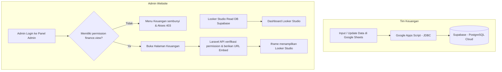
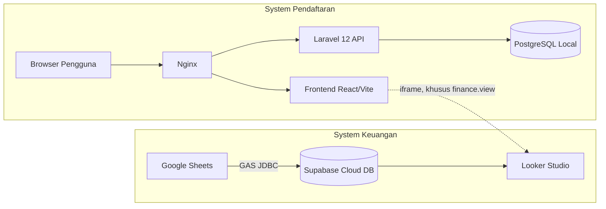

# PRD — Website Company Profile & Pendaftaran Yayasan Padindi

| | |
|---|---|
| **Nama Proyek** | Website Company Profile & Sistem Pendaftaran Siswa/Guru Yayasan Padindi |
| **Versi Dokumen** | 0.3 (Draft) |
| **Tanggal** | 29 Oktober 2026 |
| **Penulis** | [Nama penulis / tim pengembang] |
| **Mitra / Klien** | Yayasan Padindi (yayasan swasta bidang pendidikan) |
| **Status** | Draft — menunggu review dan persetujuan stakeholder |
| **Perubahan v0.3** | Penyesuaian arsitektur integrasi data keuangan: input & update data oleh tim keuangan menggunakan Google Sheets, penyimpanan database keuangan di Supabase (PostgreSQL Cloud) via Google Apps Script (JDBC), dan visualisasi dashboard di panel admin disematkan dari Looker Studio via iframe. |

---

## Daftar Isi

1. [Ringkasan Eksekutif](#1-ringkasan-eksekutif)
2. [Latar Belakang & Masalah](#2-latar-belakang--masalah)
3. [Tujuan & Metrik Keberhasilan](#3-tujuan--metrik-keberhasilan)
4. [Ruang Lingkup](#4-ruang-lingkup)
5. [Stakeholder & Pengguna](#5-stakeholder--pengguna)
6. [User Stories](#6-user-stories)
7. [Kebutuhan Fungsional](#7-kebutuhan-fungsional)
8. [Alur Pengguna](#8-alur-pengguna)
9. [Kebutuhan Non-Fungsional](#9-kebutuhan-non-fungsional)
10. [Arsitektur & Tech Stack](#10-arsitektur--tech-stack)
11. [Model Data](#11-model-data)
12. [Rancangan API](#12-rancangan-api)
13. [Desain & UX](#13-desain--ux)
14. [Keamanan & Privasi Data](#14-keamanan--privasi-data)
15. [Rencana Pengujian](#15-rencana-pengujian)
16. [Deployment & Operasional](#16-deployment--operasional)
17. [Timeline & Milestone](#17-timeline--milestone)
18. [Risiko & Mitigasi](#18-risiko--mitigasi)
19. [Asumsi & Ketergantungan](#19-asumsi--ketergantungan)
20. [Pertanyaan Terbuka](#20-pertanyaan-terbuka)
21. [Kriteria Penerimaan Proyek](#21-kriteria-penerimaan-proyek)
22. [Glosarium](#22-glosarium)
23. [Persetujuan](#23-persetujuan)

---

## 1. Ringkasan Eksekutif

Yayasan Padindi adalah yayasan swasta yang bergerak di bidang pendidikan. Proyek ini membangun sebuah website yang memiliki dua fungsi utama:

1. **Company profile** — menyajikan identitas, visi misi, unit pendidikan, kegiatan, dan informasi kontak yayasan kepada publik.
2. **Sistem pendaftaran online** — memungkinkan calon siswa (diwakili orang tua/wali) dan calon guru mendaftar secara daring, mengunggah dokumen, serta memantau status pendaftaran, sementara admin yayasan dapat memverifikasi dan mengelola data tersebut dari panel admin.

Mulai versi 0.3, panel admin juga menampilkan **dashboard keuangan** yayasan. Fitur ini bersifat tampilan baca saja: dashboard disematkan lewat iframe dari **Looker Studio**, sementara data keuangan di-input/update oleh tim keuangan menggunakan **Google Sheets** yang terhubung secara otomatis ke database **Supabase (PostgreSQL Cloud)** melalui **Google Apps Script (JDBC)**. Fitur ini hanya dapat diakses admin dengan hak akses khusus (`finance.view`).

Website utama dibangun dengan **Laravel 12** (backend/API), **React + Vite + TypeScript** (frontend), dan **PostgreSQL** (database lokal pendaftaran).

## 2. Latar Belakang & Masalah

### 2.1 Latar Belakang
Yayasan membutuhkan kehadiran digital yang kredibel untuk memperkenalkan lembaga dan menjaring calon siswa serta tenaga pendidik.

### 2.2 Masalah yang Ingin Diselesaikan
| # | Masalah | Dampak |
|---|---|---|
| 1 | Informasi yayasan belum terpusat dan mudah diakses publik | Citra lembaga kurang terbangun, calon pendaftar kesulitan mencari informasi |
| 2 | Pendaftaran siswa dan guru dilakukan manual | Proses lambat, data tersebar, rawan salah input dan berkas hilang |
| 3 | Tidak ada cara bagi pendaftar memantau status | Banyak pertanyaan berulang ke admin |
| 4 | Rekap data pendaftar dikerjakan manual | Memakan waktu panitia, sulit dianalisis |
| 5 | Tim keuangan terbiasa menggunakan spreadsheet, sementara sistem membutuhkan database terstruktur untuk laporan terpusat | Input manual ganda yang tidak efisien atau risiko ketidakcocokan data keuangan jika tidak disinkronisasikan ke database cloud |

## 3. Tujuan & Metrik Keberhasilan

### 3.1 Tujuan
- **G1** — Menyediakan website company profile yang informatif, responsif, dan mudah dikelola pihak yayasan tanpa bantuan developer.
- **G2** — Mendigitalkan pendaftaran siswa baru secara end-to-end (isi formulir sampai pengumuman status).
- **G3** — Mendigitalkan pendaftaran guru/tenaga pendidik.
- **G4** — Mempermudah admin memverifikasi, memfilter, dan mengekspor data pendaftar.
- **G5** — Menyediakan akses dashboard keuangan Looker Studio yang terbatas dan terkontrol bagi admin berwenang langsung dari panel admin, dengan memanfaatkan kebiasaan tim keuangan menggunakan Google Sheets yang tersinkronisasi ke Supabase.

### 3.2 Metrik Keberhasilan (KPI)
| Metrik | Target |
|---|---|
| Persentase pendaftaran yang diterima via online | ≥ 90% pada periode pendaftaran pertama setelah peluncuran |
| Tingkat penyelesaian formulir (mulai → kirim) | ≥ 70% |
| Rata-rata waktu verifikasi oleh admin | ≤ 2 hari kerja |
| Waktu muat halaman publik (LCP) | ≤ 2,5 detik pada jaringan 4G |
| Waktu admin merekap data pendaftar | Berkurang signifikan dibanding proses manual (ekspor ≤ 1 menit) |
| Uptime | ≥ 99% per bulan |
| Akses dashboard keuangan oleh pengguna tanpa hak akses | 0 kejadian (diuji pada uji otorisasi dan UAT) |

## 4. Ruang Lingkup

### 4.1 Dalam Lingkup (In Scope)
- Halaman publik company profile (beranda, tentang, visi misi, unit pendidikan, berita, galeri, kontak).
- Pendaftaran online siswa baru, termasuk unggah dokumen dan pelacakan status.
- Pendaftaran online guru/tenaga pendidik, termasuk unggah dokumen dan pelacakan status.
- Panel admin: manajemen konten, manajemen pendaftar, manajemen periode pendaftaran, manajemen pengguna admin, dashboard ringkasan, ekspor data.
- Notifikasi email untuk peristiwa penting (konfirmasi pendaftaran, perubahan status).
- Pengelolaan role dan hak akses admin.
- **Dashboard Keuangan** pada panel admin: menampilkan dashboard dari Looker Studio via iframe, tampilan baca saja, hanya untuk pengguna dengan hak akses `finance.view`.
- **Integrasi Keuangan**: sinkronisasi otomatis dari Google Sheets (antarmuka input tim keuangan) ke database Supabase (PostgreSQL Cloud) via Google Apps Script (JDBC).

### 4.2 Di Luar Lingkup (Out of Scope — Fase Ini)
- Sistem informasi akademik (nilai, absensi, jadwal, rapor).
- Pembayaran online (SPP, uang pendaftaran) dan integrasi payment gateway.
- Pencatatan transaksi atau modul pembukuan *native* di dalam aplikasi utama Laravel. Aplikasi utama hanya menyematkan tampilan Looker Studio; seluruh input data keuangan dilakukan oleh tim keuangan di Google Sheets.
- Aplikasi mobile native.
- Sistem tes seleksi online (CBT).
- Multi-bahasa (default: Bahasa Indonesia).

### 4.3 Kandidat Fase Berikutnya
Notifikasi WhatsApp, pembayaran online, tes seleksi online, penjadwalan wawancara otomatis, portal wali murid.

## 5. Stakeholder & Pengguna

### 5.1 Stakeholder
| Peran | Keterlibatan |
|---|---|
| Pengurus/Pimpinan Yayasan Padindi | Pemilik produk, pemberi persetujuan akhir |
| Panitia/Admin pendaftaran yayasan | Pengguna utama panel admin |
| Tim Keuangan Yayasan | Pengguna antarmuka Google Sheets untuk input/update transaksi |
| Tim pengembang | Perancangan dan implementasi |
| Kepala unit pendidikan | Penyedia konten dan kebutuhan per unit |

### 5.2 Persona Pengguna
| Persona | Deskripsi | Kebutuhan Utama |
|---|---|---|
| **Pengunjung Umum** | Masyarakat yang mencari informasi tentang yayasan | Informasi jelas, tampilan rapi, kontak mudah ditemukan |
| **Orang Tua/Wali Calon Siswa** | Mengakses terutama lewat ponsel, literasi digital beragam | Formulir sederhana, bisa disimpan sebagai draft, status pendaftaran transparan |
| **Calon Guru** | Pelamar tenaga pendidik | Formulir lamaran jelas, unggah CV/ijazah, tahu status seleksi |
| **Admin Yayasan** | Panitia yang mengelola konten dan pendaftar | Daftar pendaftar mudah difilter, verifikasi cepat, ekspor data |
| **Super Admin** | Penanggung jawab teknis/sistem | Kelola akun admin, role, dan pengaturan sistem, termasuk pengaturan dan hak akses dashboard keuangan |
| **Admin Berwenang Keuangan** | Pengguna admin yang memiliki permission `finance.view` | Membuka dashboard keuangan Looker Studio dengan cepat dan aman dari panel admin |
| **Staf Keuangan** | Tim internal keuangan yayasan | Menginput dan memperbarui data keuangan harian via Google Sheets yang familiar |

## 6. User Stories

### Pengunjung
- US-01: Sebagai pengunjung, saya ingin melihat profil dan visi misi yayasan agar saya mengenal lembaga ini.
- US-02: Sebagai pengunjung, saya ingin melihat daftar unit pendidikan beserta informasinya agar saya bisa memilih yang sesuai.
- US-03: Sebagai pengunjung, saya ingin membaca berita dan melihat galeri kegiatan agar saya tahu aktivitas yayasan.
- US-04: Sebagai pengunjung, saya ingin menemukan kontak dan lokasi yayasan agar saya dapat menghubungi atau datang langsung.

### Orang Tua / Calon Siswa
- US-05: Sebagai orang tua, saya ingin membuat akun agar saya dapat mendaftarkan anak saya dan memantau prosesnya.
- US-06: Sebagai orang tua, saya ingin mengisi formulir secara bertahap dan menyimpannya sebagai draft agar saya tidak kehilangan data bila belum selesai.
- US-07: Sebagai orang tua, saya ingin mengunggah dokumen dari ponsel agar saya tidak perlu datang membawa berkas fisik.
- US-08: Sebagai orang tua, saya ingin menerima nomor pendaftaran dan notifikasi saat status berubah agar saya selalu tahu perkembangannya.
- US-09: Sebagai orang tua, saya ingin memperbaiki data/dokumen jika admin meminta revisi agar pendaftaran anak saya tetap bisa diproses.

### Calon Guru
- US-10: Sebagai calon guru, saya ingin melihat lowongan yang tersedia agar saya bisa melamar posisi yang sesuai.
- US-11: Sebagai calon guru, saya ingin mengisi data diri, pendidikan, dan pengalaman serta mengunggah CV/ijazah agar lamaran saya lengkap.
- US-12: Sebagai calon guru, saya ingin memantau status lamaran saya agar saya tahu hasilnya.

### Admin
- US-13: Sebagai admin, saya ingin mengubah konten halaman, berita, dan galeri tanpa bantuan developer agar informasi selalu terbaru.
- US-14: Sebagai admin, saya ingin melihat, mencari, dan memfilter pendaftar agar saya dapat bekerja efisien.
- US-15: Sebagai admin, saya ingin memverifikasi dokumen dan mengubah status pendaftar (termasuk meminta revisi) agar proses seleksi terdokumentasi.
- US-16: Sebagai admin, saya ingin mengatur periode/gelombang dan kuota pendaftaran agar pendaftaran terbuka dan tertutup otomatis.
- US-17: Sebagai admin, saya ingin mengekspor data pendaftar ke Excel/PDF agar mudah dilaporkan dan diarsipkan.
- US-18: Sebagai admin, saya ingin melihat dashboard ringkasan agar saya memahami kondisi pendaftaran secara cepat.

### Super Admin
- US-19: Sebagai super admin, saya ingin mengelola akun admin dan hak aksesnya agar keamanan sistem terjaga.

### Admin Berwenang Keuangan & Tim Keuangan
- US-20: Sebagai admin yang berwenang, saya ingin melihat dashboard keuangan Looker Studio di dalam panel admin agar saya tidak perlu berpindah aplikasi untuk memantau kondisi keuangan.
- US-21: Sebagai tim keuangan, saya ingin menginput dan memperbarui data keuangan di Google Sheets agar proses kerja tetap efisien dan otomatis tersinkronisasi ke database Supabase.
- US-22: Sebagai super admin, saya ingin mengatur URL embed Looker Studio dan menentukan role mana yang boleh melihatnya agar data keuangan hanya diakses pihak yang tepat.
- US-23: Sebagai pengurus yayasan, saya ingin setiap akses ke dashboard keuangan di panel admin tercatat di log aktivitas agar penggunaannya dapat ditelusuri.

## 7. Kebutuhan Fungsional

Prioritas menggunakan skema **MoSCoW**: **M** (Must), **S** (Should), **C** (Could), **W** (Won't — fase ini).

### 7.1 Modul Company Profile (Publik)

| ID | Kebutuhan | Prioritas |
|---|---|---|
| FR-001 | Halaman **Beranda** berisi hero/banner, ringkasan yayasan, unit pendidikan, berita terbaru, dan tombol ajakan (CTA) ke pendaftaran | M |
| FR-002 | Halaman **Tentang Yayasan**: sejarah, profil, struktur organisasi | M |
| FR-003 | Halaman **Visi & Misi** | M |
| FR-004 | Halaman **Unit Pendidikan** (daftar) dan halaman detail per unit (profil, fasilitas, program, kontak) | M |
| FR-005 | Halaman **Berita/Kegiatan**: daftar dengan pagination, detail artikel, kategori | M |
| FR-006 | Halaman **Galeri** foto kegiatan (album) | S |
| FR-007 | Halaman **Kontak**: alamat, telepon, email, peta lokasi, dan formulir pesan | M |
| FR-008 | Halaman **Informasi Pendaftaran**: syarat, alur, jadwal, dan biaya (jika ada) | M |
| FR-009 | Halaman **Lowongan Guru**: daftar posisi terbuka dan syaratnya | S |
| FR-010 | Pengaturan SEO per halaman (title, meta description, Open Graph) dan sitemap | S |
| FR-011 | Footer dengan tautan cepat dan media sosial | M |
| FR-012 | Halaman statis kebijakan privasi dan syarat penggunaan | M |

### 7.2 Modul Autentikasi Pengguna (Pendaftar)

| ID | Kebutuhan | Prioritas |
|---|---|---|
| FR-020 | Registrasi akun pendaftar (nama, email, nomor telepon, kata sandi) | M |
| FR-021 | Verifikasi email setelah registrasi | S |
| FR-022 | Login dan logout | M |
| FR-023 | Lupa dan reset kata sandi lewat email | M |
| FR-024 | Pembatasan percobaan login (rate limiting) | M |
| FR-025 | Ubah profil dan kata sandi | S |

### 7.3 Modul Pendaftaran Siswa

| ID | Kebutuhan | Prioritas |
|---|---|---|
| FR-030 | Formulir pendaftaran bertahap (multi-step) dengan indikator progres | M |
| FR-031 | **Langkah 1 — Pilihan Unit**: jenjang/unit dan jalur/gelombang pendaftaran | M |
| FR-032 | **Langkah 2 — Data Calon Siswa**: nama lengkap, jenis kelamin, tempat/tanggal lahir, NIK, NISN, agama, alamat, asal sekolah | M |
| FR-033 | **Langkah 3 — Data Orang Tua/Wali**: data ayah, ibu, dan wali (nama, pekerjaan, kontak, penghasilan) | M |
| FR-034 | **Langkah 4 — Unggah Dokumen**: akta kelahiran, kartu keluarga, pas foto, rapor/ijazah terakhir | M |
| FR-035 | **Langkah 5 — Review & Kirim**: ringkasan data, pernyataan kebenaran data, persetujuan penggunaan data pribadi | M |
| FR-036 | Simpan sebagai **draft** otomatis/manual dan lanjutkan di kemudian hari | M |
| FR-037 | Validasi sisi klien dan server (format NIK, tanggal, ukuran/tipe berkas) | M |
| FR-038 | Pembuatan **nomor pendaftaran** unik setelah formulir dikirim | M |
| FR-039 | Halaman **status pendaftaran** dengan riwayat perubahan status | M |
| FR-040 | Pendaftar dapat **merevisi** data/dokumen saat status "Perlu Revisi" | M |
| FR-041 | Cetak/unduh **bukti pendaftaran** (PDF) | S |
| FR-042 | Notifikasi email: konfirmasi pengiriman, perubahan status, permintaan revisi | M |
| FR-043 | Satu akun dapat mendaftarkan lebih dari satu anak | S |
| FR-044 | Pendaftaran otomatis ditutup bila di luar periode atau kuota penuh | M |

### 7.4 Modul Pendaftaran Guru

| ID | Kebutuhan | Prioritas |
|---|---|---|
| FR-050 | Formulir lamaran multi-step | M |
| FR-051 | **Data Diri**: nama, kontak, alamat, tempat/tanggal lahir, NIK | M |
| FR-052 | **Pendidikan & Kualifikasi**: jenjang, institusi, jurusan, tahun lulus, sertifikasi | M |
| FR-053 | **Pengalaman Mengajar/Kerja**: instansi, jabatan, periode | M |
| FR-054 | **Posisi yang Dilamar**: unit, mata pelajaran/bidang | M |
| FR-055 | **Unggah Dokumen**: CV, ijazah, transkrip, sertifikat, KTP, pas foto, surat lamaran | M |
| FR-056 | Simpan draft dan lanjutkan nanti | S |
| FR-057 | Nomor lamaran unik dan halaman status lamaran | M |
| FR-058 | Notifikasi email perubahan status | M |

### 7.5 Modul Panel Admin

| ID | Kebutuhan | Prioritas |
|---|---|---|
| FR-060 | Login admin terpisah dari pendaftar | M |
| FR-061 | **Dashboard**: jumlah pendaftar per periode, unit, dan status; grafik ringkas | S |
| FR-062 | **Manajemen Pendaftar Siswa**: tabel dengan pencarian, filter (unit, status, periode), sortir, pagination | M |
| FR-063 | Detail pendaftar: lihat seluruh data dan pratinjau/unduh dokumen | M |
| FR-064 | Verifikasi per dokumen (sesuai/tidak sesuai + catatan) dan ubah status pendaftaran dengan catatan | M |
| FR-065 | Aksi massal (mis. ubah status beberapa pendaftar sekaligus) | C |
| FR-066 | **Manajemen Pendaftar Guru** dengan fitur setara FR-062–FR-064 | M |
| FR-067 | **Manajemen Periode/Gelombang**: tanggal buka/tutup, kuota per unit, status aktif | M |
| FR-068 | **Manajemen Lowongan Guru** (tambah, ubah, tutup lowongan) | S |
| FR-069 | **Manajemen Unit Pendidikan** (CRUD) | M |
| FR-070 | **CMS**: kelola halaman statis, berita, kategori, galeri, banner, kontak, dan media sosial | M |
| FR-071 | Editor teks kaya (rich text) dan unggah gambar pada berita/halaman | M |
| FR-072 | **Ekspor** data pendaftar ke Excel (XLSX/CSV) dan PDF dengan filter | M |
| FR-073 | **Pengumuman hasil**: publikasi status massal dan pengiriman notifikasi | S |
| FR-074 | Kelola pesan masuk dari formulir kontak | S |
| FR-075 | **Manajemen pengguna admin & role** (Super Admin, Admin Pendaftaran, Admin Konten) | M |
| FR-076 | **Log aktivitas** (audit trail) untuk aksi penting admin | S |
| FR-077 | Pengaturan situs (nama, logo, kontak, template email) | S |

### 7.6 Matriks Hak Akses

| Fitur | Super Admin | Admin Pendaftaran | Admin Konten |
|---|:---:|:---:|:---:|
| Kelola akun admin & role | ✅ | ❌ | ❌ |
| Pengaturan situs | ✅ | ❌ | ❌ |
| Kelola periode & kuota | ✅ | ✅ | ❌ |
| Kelola pendaftar siswa/guru | ✅ | ✅ | ❌ |
| Ekspor data pendaftar | ✅ | ✅ | ❌ |
| Kelola konten (CMS) | ✅ | ❌ | ✅ |
| Lihat dashboard pendaftaran | ✅ | ✅ | ✅ |
| Lihat dashboard keuangan (`finance.view`) | ✅ | ❌ | ❌ |
| Lihat log aktivitas | ✅ | ❌ | ❌ |

### 7.7 Modul Dashboard Keuangan (Admin)

Modul ini **menampilkan** dashboard keuangan dari Looker Studio di dalam panel admin via iframe. Data disinkronkan dari Google Sheets ke Supabase (PostgreSQL Cloud) secara terpisah.

| ID | Kebutuhan | Prioritas |
|---|---|---|
| FR-080 | Halaman **Keuangan** pada panel admin yang menampilkan dashboard Looker Studio di dalam iframe | S |
| FR-081 | Akses **hanya untuk pengguna dengan permission `finance.view`**. Pengguna tanpa hak tidak melihat menu, dan permintaan ditolak (403) | S |
| FR-082 | Alamat/URL embed Looker Studio diberikan oleh **server saat halaman dibuka**, tanpa menanam rahasia di frontend | S |
| FR-083 | Super Admin dapat mengatur URL embed Looker Studio pada pengaturan situs (`finance_dashboard_provider = 'looker_studio'`) | S |
| FR-084 | Setiap pembukaan dashboard **dicatat** di log aktivitas (`finance.dashboard_viewed`) | S |
| FR-085 | Penanganan keadaan khusus (belum dikonfigurasi, gagal dimuat) dengan pesan jelas dan tombol "Buka di tab baru" sebagai cadangan | S |
| FR-086 | **Kontrol keamanan iframe**: CSP `frame-src lookerstudio.google.com`, atribut `sandbox`, dan `referrerpolicy="no-referrer"` | S |
| FR-087 | Sinkronisasi data dari Google Sheets (input tim keuangan) ke Supabase (PostgreSQL Cloud) berjalan via Google Apps Script (JDBC) | S |

## 8. Alur Pengguna

### 8.1 Alur Pendaftaran Siswa
*(Alur standar pendaftaran siswa dari registrasi hingga pengumuman penerimaan)*

### 8.2 Alur Pendaftaran Guru
*(Alur pendaftaran guru dari pendaftaran hingga seleksi)*

### 8.3 Alur Integrasi Keuangan & Akses Dashboard

## 9. Kebutuhan Non-Fungsional

| ID | Kategori | Kebutuhan |
|---|---|---|
| NFR-01 | **Performa** | LCP halaman publik ≤ 2,5 detik (4G); respons API umum ≤ 500 ms (p95) |
| NFR-02 | **Skalabilitas** | Mampu menangani lonjakan pendaftar saat periode dibuka |
| NFR-03 | **Ketersediaan** | Uptime ≥ 99%; backup database harian |
| NFR-04 | **Keamanan** | HTTPS wajib, HSTS, sanitasi XSS, CSRF protection, rate limiting |
| NFR-05 | **Responsif** | Tampilan optimal di ponsel, tablet, dan desktop (mobile-first) |
| NFR-06 | **Aksesibilitas** | Mengacu WCAG 2.1 level AA untuk halaman publik |
| NFR-07 | **SEO** | Halaman publik dapat diindeks mesin pencari (pre-render/SSR) |
| NFR-08 | **Keamanan integrasi** | Iframe Looker Studio dibatasi CSP `frame-src lookerstudio.google.com`; URL dikirim dari backend; tidak ada data keuangan yang diolah langsung oleh aplikasi web utama |

## 10. Arsitektur & Tech Stack

### 10.1 Tech Stack

| Lapisan | Teknologi |
|---|---|
| Backend Utama | **Laravel 12** (PHP 8.2+) — REST API |
| Frontend Utama | **React + Vite + TypeScript** |
| Database Pendaftaran | **PostgreSQL (Lokal)** |
| Antarmuka Keuangan | **Google Sheets** (Input/Update Tim Keuangan) |
| Konektor Keuangan | **Google Apps Script (JDBC)** |
| Database Keuangan | **Supabase (PostgreSQL Cloud)** |
| Visualisasi Keuangan | **Looker Studio** (Disematkan via Iframe di Panel Admin) |
| Autentikasi | Laravel Sanctum (cookie/token) |
| Web Server | Nginx + PHP-FPM |

### 10.2 Diagram Arsitektur Integrasi

### 10.3 Keputusan Arsitektur Terpilih

| Topik | Keputusan Terpilih | Alasan |
|---|---|---|
| Database Pendaftaran | PostgreSQL Lokal | Performa cepat untuk aplikasi pendaftaran utama. |
| Database Keuangan | Supabase (PostgreSQL Cloud) | Penyimpanan cloud terstruktur gratis/terjangkau untuk kebutuhan prototype & integrasi Looker. |
| Antarmuka Input Keuangan | Google Sheets | Mengakomodasi kebiasaan tim keuangan tanpa membangun UI kompleks. |
| Sinkronisasi Data Keuangan | Google Apps Script (JDBC) | Gratis, bawaan Google Sheets, mudah menghubungkan Sheets ke Supabase. |
| Dashboard Keuangan Admin | Looker Studio (Iframe) | Gratis, visualisasi kaya, langsung terhubung ke Supabase. |

## 11. Model Data

### 11.1 Pengaturan Keuangan (`settings`)
Kunci pengaturan keuangan disimpan pada tabel `settings` (`group_name = 'finance'`):
- `finance_dashboard_enabled`: `true` / `false`
- `finance_dashboard_provider`: `'looker_studio'`
- `finance_dashboard_title`: `'Dashboard Keuangan Yayasan'`
- `finance_dashboard_url`: `'https://lookerstudio.google.com/embed/reporting/...'` (ditandai `is_encrypted = true`)

## 12. Rancangan API

- `GET /api/v1/admin/finance-dashboard`: Memeriksa permission `finance.view`, mencatat log `finance.dashboard_viewed`, dan mengembalikan URL embed Looker Studio.

## 13. Desain & UX

- **Halaman Keuangan Admin**: Menampilkan iframe Looker Studio full-width di area kerja panel admin dengan header judul dan tombol "Buka di tab baru".

## 14. Keamanan & Privasi Data

- **CSP Frame Source**: Nginx dikonfigurasi mengizinkan `frame-src 'self' lookerstudio.google.com`.
- **Iframe Attributes**: `sandbox="allow-scripts allow-same-origin allow-popups allow-forms"` dan `referrerpolicy="no-referrer"`.
- **Hak Akses**: Dibatasi ketat dengan permission `finance.view`.

## 15. Rencana Pengujian

- **Uji Otorisasi**: Memastikan role tanpa `finance.view` menerima respons `403` dan tidak melihat menu Keuangan.
- **Uji Integrasi**: Memastikan data yang di-input di Google Sheets masuk ke Supabase via GAS JDBC dan ter-update di Looker Studio.

## 16. Deployment & Operasional

- Konfigurasi server Nginx menyertakan header CSP untuk `lookerstudio.google.com`.
- Kredensial Supabase disimpan di konfigurasi Google Apps Script tim keuangan.

## 17. Timeline & Milestone

| Fase | Aktivitas | Durasi |
|---|---|---|
| Discovery & Design | Wireframe, PRD, finalisasi skema DB | Minggu 1–3 |
| Development Utama | Backend Laravel, Frontend React, Pendaftaran Siswa & Guru | Minggu 4–12 |
| Setup Keuangan | Setup Supabase, Script GAS JDBC Google Sheets, Dashboard Looker Studio | Minggu 13 |
| Testing & UAT | QA, uji otorisasi, UAT bersama yayasan | Minggu 14–15 |
| Go-Live | Deployment & Pelatihan | Minggu 16 |

## 18. Risiko & Mitigasi

| # | Risiko | Dampak | Mitigasi |
|---|---|---|---|
| R1 | Pengguna salah menginput format data di Google Sheets | Data ke Supabase gagal ter-update | Tambahkan validasi kolom & Data Validation di Google Sheets |
| R2 | Laporan Looker Studio tidak muncul di iframe | Tampilan keuangan kosong | Pastikan URL embed Looker Studio dikonfigurasi dengan mode 'Embed' resmi dan host `lookerstudio.google.com` diizinkan di CSP |
| R3 | Kebocoran URL embed Looker Studio | Pihak tak berwenang melihat laporan | Atur pembatasan akses (*sharing permissions*) pada Looker Studio agar hanya email Google terotorisasi yang dapat melihat laporan |

## 19. Asumsi & Ketergantungan

- Tim keuangan yayasan secara rutin memperbarui data di Google Sheets.
- Koneksi internet stabil untuk eksekusi Google Apps Script ke Supabase.

## 20. Pertanyaan Terbuka

| # | Pertanyaan | Status | Keputusan / Resolusi |
|---|---|---|---|
| Q1–Q13 | Kebutuhan umum pendaftaran & operasional | Open | Menunggu konfirmasi stakeholder. |
| Q14 | Dashboard keuangan dibuat dengan alat apa & arsitekturnya? | **Resolved** | **Looker Studio** disematkan via iframe pada panel admin. Data keuangan tersimpan di **Supabase (PostgreSQL Cloud)**, dan input/update dilakukan oleh tim keuangan via **Google Sheets** yang terhubung ke Supabase via **Google Apps Script (JDBC)**. |
| Q15 | Siapa yang boleh melihat dashboard keuangan? | **Resolved** | Hanya pengguna dengan permission `finance.view` (default: Super Admin). |
| Q16 | Isi data dashboard keuangan? | **Resolved** | Tampilan data ringkasan/agregat keuangan yayasan. |
| Q17 | Pemelihara dashboard & data? | **Resolved** | Tim Keuangan mengelola Google Sheets, tim teknis mengelola Supabase & Looker Studio. |

## 21. Kriteria Penerimaan Proyek

1. Seluruh fungsi company profile dan pendaftaran siswa/guru berjalan sesuai kebutuhan.
2. Panel admin menyajikan halaman Keuangan ber-iframe Looker Studio yang hanya dapat dibuka pengguna berhak (`finance.view`).
3. Data keuangan yang di-input di Google Sheets berhasil tersinkron ke Supabase dan terefleksi di Looker Studio.
4. Log aktivitas mencatat setiap kali halaman Keuangan dibuka oleh admin.

## 22. Glosarium

| Istilah | Arti |
|---|---|
| Supabase | Platform Backend-as-a-Service berbasis PostgreSQL di cloud |
| Looker Studio | Platform visualisasi data dan pembuatan dashboard buatan Google |
| Google Apps Script (GAS) | Platform scripting berbasis JavaScript untuk otomatisasi ekosistem Google Workspace |
| JDBC | Java Database Connectivity — modul di GAS untuk terhubung langsung ke PostgreSQL |

## 23. Persetujuan

| Nama | Jabatan | Pihak | Tanda Tangan | Tanggal |
|---|---|---|---|---|
| [Nama] | Pimpinan / Ketua | Yayasan Padindi | | |
| [Nama] | Panitia / PIC Pendaftaran | Yayasan Padindi | | |
| [Nama] | Project Manager / Lead Developer | Tim Pengembang | | |

## Riwayat Revisi

| Versi | Tanggal | Penulis | Perubahan |
|---|---|---|---|
| 0.1 | 3 Okt 2026 | [Penulis] | Draft awal |
| 0.2 | 28 Okt 2026 | [Penulis] | Menambah fitur Dashboard Keuangan (iframe generik) |
| 0.3 | 29 Okt 2026 | [Penulis] | Pembaruan arsitektur keuangan: Google Sheets + GAS JDBC + Supabase + Looker Studio. Penyesuaian Q14–Q17. |