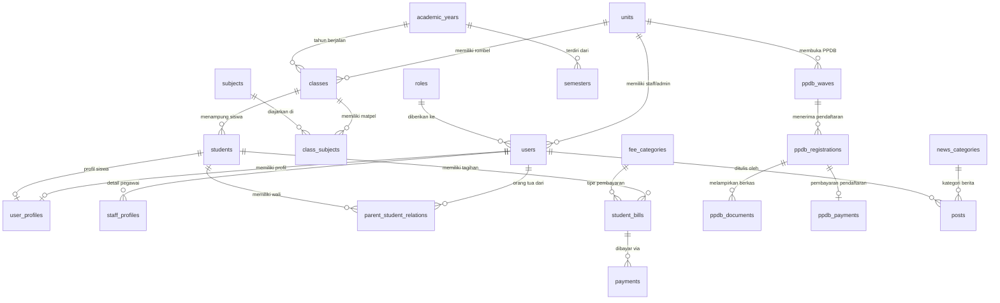

# Dokumentasi Skema Database - Yayasan Padindi v0.3

Dokumen ini memuat spesifikasi teknis lengkap skema basis data terpusat untuk **Yayasan Padindi** dan seluruh unit sekolah di bawah naungannya (SD, SMP, SMA/SMK). Skema dirancang menggunakan basis data relasional **PostgreSQL 15+** dengan dukungan pustaka ekstensi untuk enkripsi data, pencarian teks, dan pembuatan ID unik secara terdistribusi (`uuid-ossp`).

---

## 1. Arsitektur & Prinsip Desain Basis Data

1. **Mesin Database**: PostgreSQL 15+ / Supabase Infrastructure.
2. **Pengidentifikasi Utama (Primary Key)**: Penggunaan `UUIDv4` untuk seluruh tabel guna menjamin keunikan ID secara lintas modul dan mencegah *enumeration attack*.
3. **Konvensi Penamaan**: `snake_case` untuk nama tabel dan kolom, bahasa Inggris untuk entitas teknis, dan konteks spesifik lokal (seperti `nisn`, `nik`, `spp`).
4. **Audit & Soft Delete**: Setiap tabel utama memiliki kolom standar audit:
   - `created_at` (TIMESTAMP WITH TIME ZONE)
   - `updated_at` (TIMESTAMP WITH TIME ZONE)
   - `deleted_at` (TIMESTAMP WITH TIME ZONE, untuk penanganan *soft delete*)
5. **Integritas Referensial**: Menggunakan *Foreign Key Constraints* dengan strategi `ON DELETE RESTRICT` pada transaksi sensitif dan `ON DELETE CASCADE` pada data dependen.
6. **Multi-Unit Isolation**: Pemisahan data per unit sekolah (SD, SMP, SMA/SMK) diikat melalui `unit_id`.

---

## 2. Diagram Hubungan Entitas (ERD)



---

## 3. Ekstensi & Tipe Enum (Custom Types)

```sql
-- Ekstensi PostgreSQL yang Diperlukan
CREATE EXTENSION IF NOT EXISTS "uuid-ossp";
CREATE EXTENSION IF NOT EXISTS "pgcrypto";
CREATE EXTENSION IF NOT EXISTS "citext";

-- Tipe Enum untuk Role Pengguna
CREATE TYPE user_role_enum AS ENUM (
    'super_admin',
    'admin_yayasan',
    'admin_unit',
    'guru',
    'staf_keuangan',
    'staf_tu',
    'siswa',
    'orang_tua'
);

-- Tipe Enum untuk Status Siswa
CREATE TYPE student_status_enum AS ENUM (
    'calon_siswa',
    'aktif',
    'cuti',
    'lulus',
    'pindah',
    'drop_out'
);

-- Tipe Enum untuk Status PPDB
CREATE TYPE ppdb_status_enum AS ENUM (
    'draft',
    'terdaftar',
    'terverifikasi',
    'lulus_seleksi',
    'tidak_lulus',
    'batal'
);

-- Tipe Enum untuk Status Pembayaran
CREATE TYPE payment_status_enum AS ENUM (
    'pending',
    'paid',
    'failed',
    'expired',
    'refunded'
);

-- Tipe Enum untuk Metode Pembayaran
CREATE TYPE payment_method_enum AS ENUM (
    'bank_transfer',
    'virtual_account',
    'qris',
    'cash_tu',
    'e_wallet'
);
```

---

## 4. DDL & Definisi Tabel Terperinci

### Modul 1: Autentikasi & Pengguna (`auth_` & `users`)

#### Tabel `roles`
Menyimpan daftar peran dan kewenangan akses dalam sistem.

| Kolom | Tipe Data | Constraint | Keterangan |
| :--- | :--- | :--- | :--- |
| `id` | UUID | PRIMARY KEY, DEFAULT `uuid_generate_v4()` | ID Unik Peran |
| `name` | `user_role_enum` | UNIQUE, NOT NULL | Nama peran akses |
| `description` | TEXT | NULLABLE | Deskripsi rincian wewenang |
| `created_at` | TIMESTAMPTZ | NOT NULL, DEFAULT `NOW()` | Waktu dibuat |

#### Tabel `users`
Tabel utama autentikasi akun pengguna.

```sql
CREATE TABLE users (
    id UUID PRIMARY KEY DEFAULT uuid_generate_v4(),
    email CITEXT UNIQUE NOT NULL,
    password_hash VARCHAR(255) NOT NULL,
    role_id UUID NOT NULL REFERENCES roles(id) ON DELETE RESTRICT,
    unit_id UUID NULLABLE, -- Foreign key ditambahkan setelah tabel units dibuat
    phone_number VARCHAR(20) UNIQUE NULLABLE,
    is_active BOOLEAN NOT NULL DEFAULT TRUE,
    last_login_at TIMESTAMPTZ NULLABLE,
    created_at TIMESTAMPTZ NOT NULL DEFAULT NOW(),
    updated_at TIMESTAMPTZ NOT NULL DEFAULT NOW(),
    deleted_at TIMESTAMPTZ NULLABLE
);
```

#### Tabel `user_profiles`
Menyimpan data identitas personal pengguna secara detail.

```sql
CREATE TABLE user_profiles (
    id UUID PRIMARY KEY DEFAULT uuid_generate_v4(),
    user_id UUID UNIQUE NOT NULL REFERENCES users(id) ON DELETE CASCADE,
    full_name VARCHAR(150) NOT NULL,
    nik VARCHAR(16) UNIQUE NULLABLE,
    gender CHAR(1) CHECK (gender IN ('L', 'P')),
    birth_place VARCHAR(100) NULLABLE,
    birth_date DATE NULLABLE,
    address TEXT NULLABLE,
    religion VARCHAR(30) NULLABLE,
    avatar_url TEXT NULLABLE,
    created_at TIMESTAMPTZ NOT NULL DEFAULT NOW(),
    updated_at TIMESTAMPTZ NOT NULL DEFAULT NOW()
);
```

---

### Modul 2: Keorganisasian & Unit Yayasan (`foundation_`)

#### Tabel `units`
Menyimpan daftar unit pendidikan/lembaga di bawah Yayasan Padindi.

```sql
CREATE TABLE units (
    id UUID PRIMARY KEY DEFAULT uuid_generate_v4(),
    code VARCHAR(20) UNIQUE NOT NULL, -- e.g., 'SD_PADINDI', 'SMP_PADINDI', 'SMA_PADINDI'
    name VARCHAR(100) NOT NULL,
    level VARCHAR(20) NOT NULL, -- 'SD', 'SMP', 'SMA', 'SMK', 'YAYASAN'
    npsn VARCHAR(10) UNIQUE NULLABLE,
    address TEXT NOT NULL,
    phone VARCHAR(20) NULLABLE,
    email VARCHAR(100) NULLABLE,
    logo_url TEXT NULLABLE,
    is_active BOOLEAN NOT NULL DEFAULT TRUE,
    created_at TIMESTAMPTZ NOT NULL DEFAULT NOW(),
    updated_at TIMESTAMPTZ NOT NULL DEFAULT NOW()
);

-- Penambahan Foreign Key unit_id ke tabel users
ALTER TABLE users ADD CONSTRAINT fk_users_unit FOREIGN KEY (unit_id) REFERENCES units(id) ON DELETE SET NULL;
```

#### Tabel `staff_profiles`
Detail profil khusus untuk Tenaga Pendidik (Guru) dan Kependidikan (Staf TU/Keuangan).

```sql
CREATE TABLE staff_profiles (
    id UUID PRIMARY KEY DEFAULT uuid_generate_v4(),
    user_id UUID UNIQUE NOT NULL REFERENCES users(id) ON DELETE CASCADE,
    unit_id UUID NOT NULL REFERENCES units(id) ON DELETE RESTRICT,
    nip VARCHAR(30) UNIQUE NULLABLE,
    nuptk VARCHAR(30) UNIQUE NULLABLE,
    position VARCHAR(100) NOT NULL, -- e.g., 'Kepala Sekolah', 'Guru Matematika', 'Bendahara'
    employment_status VARCHAR(50) DEFAULT 'Tetap', -- 'Tetap', 'Honorer', 'Kontrak'
    hire_date DATE NULLABLE,
    created_at TIMESTAMPTZ NOT NULL DEFAULT NOW(),
    updated_at TIMESTAMPTZ NOT NULL DEFAULT NOW()
);
```

---

### Modul 3: Akademik & Kesiswaan (`academic_`)

#### Tabel `academic_years`
Tahun ajaran akademik (contoh: 2025/2026).

```sql
CREATE TABLE academic_years (
    id UUID PRIMARY KEY DEFAULT uuid_generate_v4(),
    name VARCHAR(20) NOT NULL, -- e.g., '2025/2026'
    is_active BOOLEAN NOT NULL DEFAULT FALSE,
    start_date DATE NOT NULL,
    end_date DATE NOT NULL,
    created_at TIMESTAMPTZ NOT NULL DEFAULT NOW(),
    updated_at TIMESTAMPTZ NOT NULL DEFAULT NOW()
);
```

#### Tabel `classes`
Rombongan Belajar (Rombel) atau kelas pada setiap unit sekolah.

```sql
CREATE TABLE classes (
    id UUID PRIMARY KEY DEFAULT uuid_generate_v4(),
    unit_id UUID NOT NULL REFERENCES units(id) ON DELETE RESTRICT,
    academic_year_id UUID NOT NULL REFERENCES academic_years(id) ON DELETE RESTRICT,
    grade_level INT NOT NULL, -- e.g., 1-6 (SD), 7-9 (SMP), 10-12 (SMA)
    name VARCHAR(50) NOT NULL, -- e.g., '10 IPA 1', '7 A'
    homeroom_teacher_id UUID NULLABLE REFERENCES staff_profiles(id) ON DELETE SET NULL,
    created_at TIMESTAMPTZ NOT NULL DEFAULT NOW(),
    updated_at TIMESTAMPTZ NOT NULL DEFAULT NOW()
);
```

#### Tabel `students`
Data pokok siswa terdaftar di unit sekolah.

```sql
CREATE TABLE students (
    id UUID PRIMARY KEY DEFAULT uuid_generate_v4(),
    user_id UUID UNIQUE NULLABLE REFERENCES users(id) ON DELETE SET NULL,
    unit_id UUID NOT NULL REFERENCES units(id) ON DELETE RESTRICT,
    current_class_id UUID NULLABLE REFERENCES classes(id) ON DELETE SET NULL,
    nisn VARCHAR(10) UNIQUE NULLABLE,
    nis VARCHAR(20) NULLABLE,
    status student_status_enum NOT NULL DEFAULT 'aktif',
    entry_year INT NOT NULL,
    created_at TIMESTAMPTZ NOT NULL DEFAULT NOW(),
    updated_at TIMESTAMPTZ NOT NULL DEFAULT NOW(),
    deleted_at TIMESTAMPTZ NULLABLE
);
```

#### Tabel `subjects` & `class_subjects`
Mata pelajaran dan alokasi guru pengampu di setiap kelas.

```sql
CREATE TABLE subjects (
    id UUID PRIMARY KEY DEFAULT uuid_generate_v4(),
    unit_id UUID NOT NULL REFERENCES units(id) ON DELETE CASCADE,
    code VARCHAR(20) NOT NULL,
    name VARCHAR(100) NOT NULL,
    category VARCHAR(50) DEFAULT 'Wajib', -- 'Wajib', 'Peminatan', 'Ekstrakurikuler'
    created_at TIMESTAMPTZ NOT NULL DEFAULT NOW()
);

CREATE TABLE class_subjects (
    id UUID PRIMARY KEY DEFAULT uuid_generate_v4(),
    class_id UUID NOT NULL REFERENCES classes(id) ON DELETE CASCADE,
    subject_id UUID NOT NULL REFERENCES subjects(id) ON DELETE CASCADE,
    teacher_id UUID NULLABLE REFERENCES staff_profiles(id) ON DELETE SET NULL,
    kkm NUMERIC(5,2) DEFAULT 75.00,
    created_at TIMESTAMPTZ NOT NULL DEFAULT NOW(),
    UNIQUE(class_id, subject_id)
);
```

#### Tabel `parent_student_relations`
Pemetaan hubungan relasi antara akun orang tua/wali dengan siswa.

```sql
CREATE TABLE parent_student_relations (
    id UUID PRIMARY KEY DEFAULT uuid_generate_v4(),
    parent_user_id UUID NOT NULL REFERENCES users(id) ON DELETE CASCADE,
    student_id UUID NOT NULL REFERENCES students(id) ON DELETE CASCADE,
    relationship_type VARCHAR(20) NOT NULL, -- 'Ayah', 'Ibu', 'Wali'
    created_at TIMESTAMPTZ NOT NULL DEFAULT NOW(),
    UNIQUE(parent_user_id, student_id)
);
```

---

### Modul 4: Penerimaan Peserta Didik Baru (`ppdb_`)

#### Tabel `ppdb_waves`
Gelombang pendaftaran siswa baru per unit sekolah.

```sql
CREATE TABLE ppdb_waves (
    id UUID PRIMARY KEY DEFAULT uuid_generate_v4(),
    unit_id UUID NOT NULL REFERENCES units(id) ON DELETE CASCADE,
    academic_year_id UUID NOT NULL REFERENCES academic_years(id) ON DELETE CASCADE,
    name VARCHAR(50) NOT NULL, -- e.g., 'Gelombang 1 Ujian Masuk'
    start_date DATE NOT NULL,
    end_date DATE NOT NULL,
    registration_fee NUMERIC(12,2) NOT NULL DEFAULT 0.00,
    is_active BOOLEAN NOT NULL DEFAULT TRUE,
    created_at TIMESTAMPTZ NOT NULL DEFAULT NOW()
);
```

#### Tabel `ppdb_registrations`
Data formulir pendaftaran calon siswa baru.

```sql
CREATE TABLE ppdb_registrations (
    id UUID PRIMARY KEY DEFAULT uuid_generate_v4(),
    registration_number VARCHAR(30) UNIQUE NOT NULL, -- e.g., 'PPDB-2026-SD-001'
    unit_id UUID NOT NULL REFERENCES units(id) ON DELETE RESTRICT,
    wave_id UUID NOT NULL REFERENCES ppdb_waves(id) ON DELETE RESTRICT,
    full_name VARCHAR(150) NOT NULL,
    nisn VARCHAR(10) NULLABLE,
    gender CHAR(1) CHECK (gender IN ('L', 'P')),
    birth_place VARCHAR(100) NOT NULL,
    birth_date DATE NOT NULL,
    parent_name VARCHAR(150) NOT NULL,
    parent_phone VARCHAR(20) NOT NULL,
    parent_email VARCHAR(100) NULLABLE,
    address TEXT NOT NULL,
    previous_school VARCHAR(150) NULLABLE,
    status ppdb_status_enum NOT NULL DEFAULT 'draft',
    notes TEXT NULLABLE,
    created_at TIMESTAMPTZ NOT NULL DEFAULT NOW(),
    updated_at TIMESTAMPTZ NOT NULL DEFAULT NOW()
);
```

#### Tabel `ppdb_documents`
Dokumen lampiran fisik calon siswa (Kartu Keluarga, Akta Kelahiran, Ijazah).

```sql
CREATE TABLE ppdb_documents (
    id UUID PRIMARY KEY DEFAULT uuid_generate_v4(),
    registration_id UUID NOT NULL REFERENCES ppdb_registrations(id) ON DELETE CASCADE,
    document_type VARCHAR(50) NOT NULL, -- 'kk', 'akta_kelahiran', 'ijazah', 'pas_foto'
    file_url TEXT NOT NULL,
    is_verified BOOLEAN DEFAULT FALSE,
    verified_at TIMESTAMPTZ NULLABLE,
    verified_by UUID NULLABLE REFERENCES users(id) ON DELETE SET NULL,
    created_at TIMESTAMPTZ NOT NULL DEFAULT NOW()
);
```

---

### Modul 5: Keuangan & Pembayaran (`finance_`)

#### Tabel `fee_categories`
Kategori jenis tagihan keuangan sekolah/yayasan.

```sql
CREATE TABLE fee_categories (
    id UUID PRIMARY KEY DEFAULT uuid_generate_v4(),
    unit_id UUID NOT NULL REFERENCES units(id) ON DELETE CASCADE,
    code VARCHAR(30) NOT NULL, -- 'SPP', 'UANG_GEDUNG', 'SERAGAM', 'EKTRA'
    name VARCHAR(100) NOT NULL,
    description TEXT NULLABLE,
    created_at TIMESTAMPTZ NOT NULL DEFAULT NOW()
);
```

#### Tabel `student_bills`
Daftar tagihan wajib bagi setiap siswa.

```sql
CREATE TABLE student_bills (
    id UUID PRIMARY KEY DEFAULT uuid_generate_v4(),
    student_id UUID NOT NULL REFERENCES students(id) ON DELETE CASCADE,
    fee_category_id UUID NOT NULL REFERENCES fee_categories(id) ON DELETE RESTRICT,
    title VARCHAR(150) NOT NULL, -- e.g., 'SPP Bulan Oktober 2026'
    amount NUMERIC(12,2) NOT NULL,
    due_date DATE NOT NULL,
    status payment_status_enum NOT NULL DEFAULT 'pending',
    created_at TIMESTAMPTZ NOT NULL DEFAULT NOW(),
    updated_at TIMESTAMPTZ NOT NULL DEFAULT NOW()
);
```

#### Tabel `payments`
Data transaksi pembayaran yang berhasil diselesaikan maupun yang sedang berlangsung.

```sql
CREATE TABLE payments (
    id UUID PRIMARY KEY DEFAULT uuid_generate_v4(),
    bill_id UUID NULLABLE REFERENCES student_bills(id) ON DELETE SET NULL,
    ppdb_registration_id UUID NULLABLE REFERENCES ppdb_registrations(id) ON DELETE SET NULL,
    transaction_code VARCHAR(50) UNIQUE NOT NULL,
    amount_paid NUMERIC(12,2) NOT NULL,
    payment_method payment_method_enum NOT NULL,
    payment_status payment_status_enum NOT NULL DEFAULT 'pending',
    proof_url TEXT NULLABLE, -- URL bukti transfer jika manual
    gateway_reference VARCHAR(100) NULLABLE, -- Reference ID Midtrans/Xendit/Doku
    paid_at TIMESTAMPTZ NULLABLE,
    created_at TIMESTAMPTZ NOT NULL DEFAULT NOW(),
    updated_at TIMESTAMPTZ NOT NULL DEFAULT NOW(),
    CONSTRAINT check_payment_source CHECK (
        (bill_id IS NOT NULL AND ppdb_registration_id IS NULL) OR
        (bill_id IS NULL AND ppdb_registration_id IS NOT NULL)
    )
);
```

---

### Modul 6: Content Management System & Website Publik (`cms_`)

#### Tabel `news_categories` & `posts`
Pengelolaan publikasi berita, pengumuman, dan artikel kegiatan sekolah/yayasan.

```sql
CREATE TABLE news_categories (
    id UUID PRIMARY KEY DEFAULT uuid_generate_v4(),
    name VARCHAR(50) NOT NULL,
    slug VARCHAR(60) UNIQUE NOT NULL,
    created_at TIMESTAMPTZ NOT NULL DEFAULT NOW()
);

CREATE TABLE posts (
    id UUID PRIMARY KEY DEFAULT uuid_generate_v4(),
    unit_id UUID NULLABLE REFERENCES units(id) ON DELETE SET NULL, -- NULL jika berita tingkat Yayasan
    category_id UUID NOT NULL REFERENCES news_categories(id) ON DELETE RESTRICT,
    author_id UUID NOT NULL REFERENCES users(id) ON DELETE RESTRICT,
    title VARCHAR(200) NOT NULL,
    slug VARCHAR(220) UNIQUE NOT NULL,
    content TEXT NOT NULL,
    featured_image TEXT NULLABLE,
    is_published BOOLEAN DEFAULT FALSE,
    published_at TIMESTAMPTZ NULLABLE,
    created_at TIMESTAMPTZ NOT NULL DEFAULT NOW(),
    updated_at TIMESTAMPTZ NOT NULL DEFAULT NOW(),
    deleted_at TIMESTAMPTZ NULLABLE
);
```

#### Tabel `events` & `facilities`
Pengelolaan jadwal agenda kegiatan dan sarana prasarana unit.

```sql
CREATE TABLE events (
    id UUID PRIMARY KEY DEFAULT uuid_generate_v4(),
    unit_id UUID NULLABLE REFERENCES units(id) ON DELETE CASCADE,
    title VARCHAR(150) NOT NULL,
    description TEXT NULLABLE,
    location VARCHAR(150) NULLABLE,
    start_time TIMESTAMPTZ NOT NULL,
    end_time TIMESTAMPTZ NOT NULL,
    banner_url TEXT NULLABLE,
    created_at TIMESTAMPTZ NOT NULL DEFAULT NOW()
);

CREATE TABLE facilities (
    id UUID PRIMARY KEY DEFAULT uuid_generate_v4(),
    unit_id UUID NOT NULL REFERENCES units(id) ON DELETE CASCADE,
    name VARCHAR(100) NOT NULL,
    description TEXT NULLABLE,
    image_url TEXT NULLABLE,
    created_at TIMESTAMPTZ NOT NULL DEFAULT NOW()
);
```

---

### Modul 7: Audit Log & Pengaturan Sistem (`audit_` & `system_`)

#### Tabel `activity_logs`
Mencatat seluruh rekam jejak aktivitas kritis pengguna untuk keperluan audit keamanan.

```sql
CREATE TABLE activity_logs (
    id UUID PRIMARY KEY DEFAULT uuid_generate_v4(),
    user_id UUID NULLABLE REFERENCES users(id) ON DELETE SET NULL,
    action VARCHAR(100) NOT NULL, -- e.g., 'UPDATE_STUDENT_STATUS', 'CREATE_PAYMENT'
    entity_name VARCHAR(50) NOT NULL, -- e.g., 'students', 'payments'
    entity_id UUID NULLABLE,
    payload JSONB NULLABLE, -- Perubahan data sebelum dan sesudah
    ip_address VARCHAR(45) NULLABLE,
    user_agent TEXT NULLABLE,
    created_at TIMESTAMPTZ NOT NULL DEFAULT NOW()
);
```

---

## 5. Strategi Indeks & Optimalisasi Performa

Untuk menjaga kinerja pencarian dan skalabilitas data seiring berjalannya waktu, indeks B-Tree dan GIN diterapkan pada kolom yang sering diakses:

```sql
-- Indeks Pencarian Autentikasi
CREATE INDEX idx_users_email ON users(email) WHERE deleted_at IS NULL;
CREATE INDEX idx_users_role_unit ON users(role_id, unit_id);

-- Indeks Akademik & Kesiswaan
CREATE INDEX idx_students_nisn ON students(nisn);
CREATE INDEX idx_students_unit_class ON students(unit_id, current_class_id);

-- Indeks Transaksi Keuangan & PPDB
CREATE INDEX idx_student_bills_student_status ON student_bills(student_id, status);
CREATE INDEX idx_payments_transaction_code ON payments(transaction_code);
CREATE INDEX idx_ppdb_reg_number ON ppdb_registrations(registration_number);

-- Indeks CMS & JSONB Audit
CREATE INDEX idx_posts_slug ON posts(slug) WHERE is_published = TRUE;
CREATE INDEX idx_activity_logs_user_action ON activity_logs(user_id, action);
CREATE INDEX idx_activity_logs_payload_gin ON activity_logs USING GIN (payload);
```

---

## 6. Kebijakan Keamanan Data (Row Level Security - RLS)

Prinsip keamanan diterapkan menggunakan *Row Level Security* (RLS) PostgreSQL untuk membatasi akses data antar-unit sekolah dan hak akses peran:

```sql
-- Mengaktifkan RLS pada tabel sensitif
ALTER TABLE students ENABLE ROW LEVEL SECURITY;
ALTER TABLE student_bills ENABLE ROW LEVEL SECURITY;

-- Kebijakan: Admin Unit hanya dapat melihat siswa di unit miliknya
CREATE POLICY admin_unit_students_policy ON students
    FOR ALL
    USING (
        unit_id = (SELECT unit_id FROM users WHERE id = auth.uid())
        OR 
        (SELECT name FROM roles WHERE id = (SELECT role_id FROM users WHERE id = auth.uid())) IN ('super_admin', 'admin_yayasan')
    );

-- Kebijakan: Orang Tua hanya dapat melihat tagihan anaknya sendiri
CREATE POLICY parent_bills_policy ON student_bills
    FOR SELECT
    USING (
        student_id IN (
            SELECT student_id 
            FROM parent_student_relations 
            WHERE parent_user_id = auth.uid()
        )
    );
```

---

## 7. Pemetaaan Foreign Key & Relasi Utama

| Tabel Sumber | Kolom FK | Tabel Acuan | Kolom PK | Strategi Hapus |
| :--- | :--- | :--- | :--- | :--- |
| `users` | `role_id` | `roles` | `id` | RESTRICT |
| `users` | `unit_id` | `units` | `id` | SET NULL |
| `user_profiles` | `user_id` | `users` | `id` | CASCADE |
| `staff_profiles` | `user_id` | `users` | `id` | CASCADE |
| `students` | `unit_id` | `units` | `id` | RESTRICT |
| `students` | `current_class_id`| `classes` | `id` | SET NULL |
| `ppdb_registrations` | `wave_id` | `ppdb_waves` | `id` | RESTRICT |
| `student_bills` | `student_id` | `students` | `id` | CASCADE |
| `payments` | `bill_id` | `student_bills` | `id` | SET NULL |
| `posts` | `author_id` | `users` | `id` | RESTRICT |

---

## 8. Data Inisialisasi Sistem (Seeding Reference)

```sql
-- Inisialisasi Peran Utama Sistem (Roles)
INSERT INTO roles (id, name, description) VALUES
    ('11111111-1111-1111-1111-111111111111', 'super_admin', 'Akses penuh ke seluruh konfigurasi sistem'),
    ('22222222-2222-2222-2222-222222222222', 'admin_yayasan', 'Akses pengawasan seluruh unit Yayasan Padindi'),
    ('33333333-3333-3333-3333-333333333333', 'admin_unit', 'Administrator khusus unit sekolah (SD/SMP/SMA)'),
    ('44444444-4444-4444-4444-444444444444', 'guru', 'Akses input nilai, materi, dan absensi'),
    ('55555555-5555-5555-5555-555555555555', 'staf_keuangan', 'Akses tata kelola SPP & pembayaran'),
    ('66666666-6666-6666-6666-666666666666', 'siswa', 'Akses portal siswa dan materi'),
    ('77777777-7777-7777-7777-777777777777', 'orang_tua', 'Akses laporan nilai dan pembayaran anak');

-- Inisialisasi Unit Sekolah Yayasan Padindi
INSERT INTO units (code, name, level, address) VALUES
    ('YAYASAN', 'Yayasan Padindi Pusat', 'YAYASAN', 'Jl. Prepedan Dalam No.38, Kamal, Kalideres, Jakarta Barat'),
    ('SD_PADINDI', 'SD Padindi', 'SD', 'Jl. Papanggo II D No.70, Tanjung Priok, Jakarta Utara'),
    ('SMP_PADINDI', 'SMP Padindi', 'SMP', 'Jl. Papanggo II D No.70, Tanjung Priok, Jakarta Utara'),
    ('SMA_PADINDI', 'SMAS Padindi', 'SMA', 'Jl. Prepedan Dalam No.38, Kamal, Kalideres, Jakarta Barat');
```