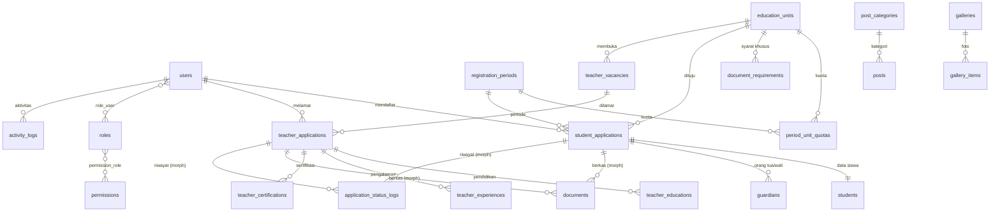

# Skema Database — Website Yayasan Padindi

| | |
|---|---|
| **Versi** | 0.1 (Draft), selaras dengan PRD v0.1 |
| **DBMS** | PostgreSQL 15+ |
| **Framework** | Laravel 12 |
| **File DDL** | `schema-padindi.sql` (30 tabel, sudah lolos validasi sintaks PostgreSQL) |

Dokumen ini menjelaskan **struktur dan alasan desain**. Definisi kolom lengkap (tipe data, constraint, indeks) ada di `schema-padindi.sql`.

---

## 1. Konvensi

| Topik | Keputusan |
|---|---|
| Primary key | `bigint` identity (`$table->id()` di Laravel) |
| Waktu | `timestamptz` (gunakan `timestampsTz()` di migration) |
| Enum | `varchar` + `CHECK`, bukan tipe enum native PostgreSQL. Pada PHP gunakan Backed Enum. Lebih mudah diubah lewat migration |
| Soft delete | Kolom `deleted_at` pada tabel inti (users, aplikasi pendaftaran, unit, periode, konten) |
| Unique + soft delete | Memakai *partial unique index* `WHERE deleted_at IS NULL` agar slug/email bisa dipakai ulang setelah data dihapus |
| Gender | `L` / `P` |
| Data sensitif (NIK) | Kolom `nik` bertipe `text` diisi nilai **terenkripsi** (cast `encrypted` Laravel). Kolom `nik_hash` (SHA-256) dipakai untuk pencarian dan deteksi duplikat, karena data terenkripsi tidak bisa dicari langsung |
| Relasi polimorfik | `documents` dan `application_status_logs` dipakai bersama oleh pendaftaran siswa dan guru. Gunakan `Relation::enforceMorphMap` dengan alias `student_application` dan `teacher_application` |
| Pencarian nama | Ekstensi `pg_trgm` + indeks GIN untuk `ILIKE '%...%'` pada panel admin |
| Tabel bawaan Laravel | `sessions`, `cache`, `jobs`, `job_batches`, `failed_jobs`, `password_reset_tokens`, `personal_access_tokens` dibuat oleh artisan, tidak masuk DDL |

## 2. Diagram Relasi (ERD)



## 3. Kamus Tabel

### 3.1 Pengguna & Hak Akses

| Tabel | Fungsi | Catatan |
|---|---|---|
| `users` | Semua akun, dibedakan oleh `user_type` (`applicant` / `admin`) | Email unik (case-insensitive) di antara akun yang belum dihapus |
| `roles` | Role admin: `super_admin`, `admin_registration`, `admin_content` | |
| `permissions` | Hak akses granular, contoh `applications.verify`, `applications.export` | |
| `permission_role`, `role_user` | Tabel pivot | |

> Jika memakai paket **spatie/laravel-permission**, lewati keempat tabel terakhir dan gunakan migration bawaan paket.

### 3.2 Master Data Pendaftaran

| Tabel | Fungsi | Aturan penting |
|---|---|---|
| `education_units` | Unit pendidikan (PAUD/TK/SD/SMP/SMA/SMK/lainnya) | `facilities` dan `programs` bertipe `jsonb` agar fleksibel untuk halaman profil unit |
| `registration_periods` | Periode/gelombang PPDB | `closes_at > opens_at`; `registration_fee` hanya informasi (pembayaran online di luar lingkup) |
| `period_unit_quotas` | Kuota per periode per unit | Unik pada pasangan (periode, unit) |
| `document_requirements` | Daftar dokumen wajib yang dapat diatur per jenis pendaftar (siswa/guru) dan per unit | `education_unit_id` NULL berarti berlaku untuk semua unit. Menjawab risiko R6 (syarat berbeda antar-unit) |
| `registration_counters` | Penghitung nomor pendaftaran | Aman terhadap akses bersamaan (lihat bagian 6) |

### 3.3 Pendaftaran Siswa

| Tabel | Fungsi | Aturan penting |
|---|---|---|
| `student_applications` | Entitas utama pendaftaran: pemilik akun, periode, unit, status, nomor | Satu akun dapat memiliki banyak pendaftaran (mendukung FR-043). `current_step` (1-5) menyimpan posisi form multi-step untuk draft. Status selain `draft` wajib memiliki nomor pendaftaran dan `submitted_at` |
| `students` | Data calon siswa (1:1 dengan pendaftaran) | NIK terenkripsi + `nik_hash` |
| `guardians` | Ayah, ibu, wali | Unik per (pendaftaran, hubungan); satu baris ditandai `is_primary_contact` |

### 3.4 Pendaftaran Guru

| Tabel | Fungsi | Aturan penting |
|---|---|---|
| `teacher_vacancies` | Lowongan guru | Tampil di publik bila `is_published` dan belum lewat `closes_at` |
| `teacher_applications` | Lamaran guru, memuat data diri pelamar | `teacher_vacancy_id` boleh NULL untuk lamaran terbuka (tanpa lowongan spesifik) |
| `teacher_educations` | Riwayat pendidikan (banyak) | IPK 0-4,00 |
| `teacher_experiences` | Riwayat pengalaman (banyak) | `end_date` NULL = masih berjalan |
| `teacher_certifications` | Sertifikasi, misal sertifikat pendidik (banyak) | Tabel tambahan dari PRD untuk memenuhi FR-052 |

### 3.5 Dokumen & Riwayat

| Tabel | Fungsi | Aturan penting |
|---|---|---|
| `documents` | Berkas unggahan milik pendaftaran siswa/guru | Disimpan di disk **privat**. Satu "slot" dokumen unik per (pemilik, `document_type`, `sequence`) selama belum dihapus, sehingga unggah ulang = ganti berkas lama (soft delete). Status verifikasi: `pending` / `valid` / `invalid` |
| `application_status_logs` | Riwayat setiap perubahan status beserta catatan dan pelaku | Hanya ditambah (append-only), tidak diubah. Sumber tampilan "riwayat status" untuk pendaftar |

### 3.6 Konten (CMS)

| Tabel | Fungsi |
|---|---|
| `posts`, `post_categories` | Berita/kegiatan. Status `draft` / `published` / `archived` |
| `pages` | Halaman statis (tentang, visi misi, kebijakan privasi, dll.) |
| `organization_members` | Struktur organisasi sebagai data (nama, jabatan, foto, urutan) |
| `galleries`, `gallery_items` | Album dan foto |
| `banners` | Banner beranda, dengan jadwal tayang opsional |
| `contact_messages` | Pesan dari formulir kontak. Status `new` / `read` / `replied` |
| `settings` | Pengaturan situs berbentuk key-value (nama situs, kontak, media sosial) |

### 3.7 Audit

| Tabel | Fungsi |
|---|---|
| `activity_logs` | Jejak aksi penting admin (ubah status, ekspor data, hapus). Detail perubahan disimpan di `properties` (`jsonb`) |

## 4. Nilai Status

**Pendaftaran siswa** (`student_applications.status`)

```
draft → submitted → in_review ⇄ revision_required
                        ↓
                    verified → accepted | rejected | waitlisted
```

**Lamaran guru** (`teacher_applications.status`)

```
draft → submitted → administrative_review → interview_test → passed | failed | reserve
```

> Pada versi ini lamaran guru belum memiliki status revisi. Jika yayasan membutuhkannya, cukup tambahkan nilai `revision_required` pada CHECK constraint.

Transisi status divalidasi di aplikasi (misalnya lewat state machine sederhana pada Service/Enum), sedangkan database menjaga nilai yang valid dan kelengkapan nomor pendaftaran.

## 5. Strategi Indeks

| Kebutuhan | Indeks |
|---|---|
| Tabel pendaftar admin dengan filter periode/unit/status | `student_applications (registration_period_id, education_unit_id, status)` |
| Pendaftar melihat pendaftarannya | `student_applications (user_id)` |
| Cari berdasarkan nomor pendaftaran | Unique `registration_number` |
| Cari berdasarkan nama | GIN trigram pada `students.full_name` dan `teacher_applications.full_name` |
| Cek duplikat NIK | `nik_hash` pada `students` dan `teacher_applications` |
| Halaman publik berita | `posts (status, published_at DESC)` |
| Cek periode aktif | `registration_periods (is_active, opens_at, closes_at)` |
| Riwayat dan dokumen per pendaftaran | `(type, id)` pada `documents` dan `application_status_logs` |

## 6. Aturan Bisnis yang Perlu Ditangani di Aplikasi

1. **Nomor pendaftaran.** Dibuat saat pendaftaran dikirim, bukan saat draft. Contoh format `PPDB-2027-00001`. Gunakan `registration_counters` dengan satu statement atomik:
   ```sql
   INSERT INTO registration_counters (scope, last_number)
   VALUES ('student-2027', 1)
   ON CONFLICT (scope) DO UPDATE
     SET last_number = registration_counters.last_number + 1,
         updated_at = now()
   RETURNING last_number;
   ```
   Jalankan di dalam transaksi yang sama dengan pengiriman pendaftaran.
2. **Kuota.** Hitung jumlah pendaftaran berstatus `accepted` (atau `verified`, sesuai kebijakan yayasan) per unit/periode dan bandingkan dengan `period_unit_quotas.quota`. Gunakan transaksi + penguncian baris saat menerima pendaftar agar kuota tidak terlewati.
3. **Periode aktif.** Pendaftaran baru hanya boleh dikirim jika `now()` berada di antara `opens_at` dan `closes_at`.
4. **Deteksi duplikat.** Sebelum kirim, cek `nik_hash` yang sama pada periode yang sama dan tampilkan peringatan (jangan langsung blokir, karena bisa jadi salah ketik atau pendaftaran ulang).
5. **Kelengkapan dokumen.** Validasi terhadap `document_requirements` untuk jenis pendaftar dan unit terkait sebelum status boleh menjadi `submitted`.
6. **Hak akses data.** Pendaftar hanya dapat membaca/ubah pendaftaran miliknya (Laravel Policy). Pendaftaran hanya bisa diubah saat status `draft` atau `revision_required`.
7. **Setiap perubahan status** menulis satu baris ke `application_status_logs` dan, untuk aksi admin, satu baris ke `activity_logs`.
8. **File dokumen** diakses lewat endpoint terotorisasi atau URL bertanda tangan, tidak pernah lewat URL publik langsung.
9. **Retensi data.** Siapkan job terjadwal untuk menghapus/anonimkan data pendaftar yang tidak diterima setelah masa retensi yang disepakati yayasan (UU PDP).

## 7. Urutan Migration yang Disarankan

1. `users`, `roles`, `permissions`, `permission_role`, `role_user`
2. `education_units`, `registration_periods`, `period_unit_quotas`, `document_requirements`, `registration_counters`
3. `student_applications`, `students`, `guardians`
4. `teacher_vacancies`, `teacher_applications`, `teacher_educations`, `teacher_experiences`, `teacher_certifications`
5. `documents`, `application_status_logs`
6. `post_categories`, `posts`, `pages`, `organization_members`, `galleries`, `gallery_items`, `banners`, `contact_messages`, `settings`
7. `activity_logs`
8. Migration khusus PostgreSQL: `CREATE EXTENSION pg_trgm`, indeks GIN, partial unique index, dan CHECK constraint. Gunakan `DB::statement(...)` karena Schema Builder tidak mendukung semuanya.

## 8. Seeder Awal

| Seeder | Isi |
|---|---|
| `RoleSeeder` | `super_admin`, `admin_registration`, `admin_content` + matriks permission sesuai PRD bagian 7.6 |
| `AdminUserSeeder` | Satu akun Super Admin awal (kata sandi diganti saat login pertama) |
| `EducationUnitSeeder` | Unit pendidikan yayasan (menunggu data dari yayasan) |
| `DocumentRequirementSeeder` | Dokumen siswa: akta kelahiran, kartu keluarga, pas foto, rapor/ijazah terakhir. Dokumen guru: CV, ijazah, transkrip, sertifikat, KTP, pas foto, surat lamaran |
| `SettingSeeder` | Kunci pengaturan: `site_name`, `site_logo`, `contact_email`, `contact_phone`, `contact_address`, `social_*` |
| `PageSeeder` | Halaman statis awal: tentang, visi misi, kebijakan privasi |

## 9. Catatan Implementasi Laravel

- Pasang `Relation::enforceMorphMap(['student_application' => StudentApplication::class, 'teacher_application' => TeacherApplication::class])`.
- Pada model `Student`, `Guardian`, `TeacherApplication`: `protected $casts = ['nik' => 'encrypted']`, dan isi `nik_hash` lewat mutator (`hash('sha256', $nik)`; pertimbangkan menambah *pepper* dari config agar hash tidak mudah ditebak).
- Pakai `SoftDeletes` pada model yang memiliki `deleted_at`.
- Pakai Backed Enum PHP untuk status dan cast di model, supaya nilai tidak menyebar sebagai string literal.
- Untuk `jsonb`, gunakan `$table->jsonb('facilities')->default('[]')` dan cast `array`.

## 10. Hal yang Perlu Dikonfirmasi dengan Yayasan

Jawaban berikut dapat mengubah skema:

| # | Pertanyaan | Dampak pada skema |
|---|---|---|
| 1 | Adakah jalur pendaftaran (reguler, prestasi, afirmasi)? | Kolom `track` bisa menjadi tabel master `registration_tracks` dengan kuota sendiri |
| 2 | Apakah ada tes/wawancara siswa yang nilainya perlu disimpan? | Tabel baru `student_assessments` (jadwal, skor, penguji) |
| 3 | Apakah data penghasilan orang tua wajib? | Kolom `income_range` bisa dibuang atau dijadikan wajib |
| 4 | Perlu format data selaras Dapodik/PPDB daerah? | Penambahan kolom (misalnya NPSN, kode wilayah) dan format ekspor khusus |
| 5 | Biaya pendaftaran dibayar online? | Tabel `payments` + integrasi payment gateway (saat ini di luar lingkup) |
| 6 | Satu anak boleh memilih lebih dari satu unit/pilihan? | `education_unit_id` menjadi tabel `application_choices` (pilihan 1, 2, dst.) |
| 7 | Berapa lama retensi data pendaftar yang tidak diterima? | Aturan job penghapusan terjadwal |
